<p align="center">
  
</p>

<h1 align="center">RaceDay Event Management System</h1>
<h3 align="center">PROG6212 Programming 2B - Portfolio of Evidence | Parts 1, 2 &amp; 3</h3>
<h4 align="center">System Planning, SQL Server Database, RESTful API, Swagger, Automated Testing, MVC Web Application, Azure Blob Storage, Docker and GitHub Actions</h4>

<p align="center">
  <a href="https://dotnet.microsoft.com/en-us/download/dotnet/10.0"></a>
  <a href="https://learn.microsoft.com/en-us/aspnet/core/"></a>
  <a href="https://learn.microsoft.com/en-us/ef/core/"></a>
  <a href="https://www.microsoft.com/sql-server/"></a>
  <a href="https://learn.microsoft.com/sql/ssms/"></a>
  <a href="https://swagger.io/"></a>
  <a href="https://github.com/actions"></a>
  <a href="https://learn.microsoft.com/en-us/dotnet/core/testing/unit-testing-mstest-intro"></a>
  
  <a href="https://learn.microsoft.com/en-us/aspnet/core/mvc/overview"></a>
  <a href="https://getbootstrap.com/"></a>
  <a href="https://learn.microsoft.com/en-us/azure/storage/blobs/"></a>
  <a href="https://www.docker.com/"></a>
  
</p>

---

## Video Demonstrations

<p align="center">
  <a href="https://youtu.be/qvvP-GEzvvI">
    
  </a>
  &nbsp;
  <a href="https://youtu.be/-S8MC3IVvxw">
    
  </a>
  &nbsp;
  <a href="https://youtu.be/ADD_PART_3_VIDEO_ID">
    
  </a>
</p>

---

## Student Details

| Name | Student Number | Module | Assessment | Project |
|---|---|---|---|---|
| Varen Venketraju | ST10481447 | PROG6212 - Programming 2B | Portfolio of Evidence - Parts 1, 2 & 3 | RaceDay Event Management System |

**Repository:** [PROG6212 RaceDay repository](https://github.com/EMKNDN/emkndn-prog6212-2026-prog6212-poe-varen2025)  
**Part 2 branch:** `part-2-raceday-api`  
**Part 3 branch:** `part-3-raceday-mvc`  
**Submission:** GitHub repository link submitted on ARC 

---

## Table of Contents

- [Overview](#overview)

### Part 1 - Planning and Database Documentation

- [Part 1 Overview](#part-1-overview)
- [Part 1 Scope](#part-1-scope)
- [Rubric Coverage Summary](#rubric-coverage-summary)
- [System Roles](#system-roles)
- [Planning Architecture](#planning-architecture)
- [Technology and Tooling](#technology-and-tooling)
- [Project Structure](#project-structure)
- [Part 1 Deliverables](#part-1-deliverables)
- [Entity Relationship Diagram](#entity-relationship-diagram)
- [Entity Design Detail](#entity-design-detail)
- [Relationship and Cardinality Detail](#relationship-and-cardinality-detail)
- [Database Design Decisions](#database-design-decisions)
- [API Endpoint Plan and Design Detail](#api-endpoint-plan-and-design-detail)
- [Planned HTTP Response Strategy](#planned-http-response-strategy)
- [SQL Database Implementation](#sql-database-implementation)
- [Validation and Data Integrity Practices](#validation-and-data-integrity-practices)
- [Seed Data](#seed-data)
- [Running and Verifying the SQL Script](#running-and-verifying-the-sql-script)
- [SQL Execution Evidence](#sql-execution-evidence)
- [GitHub Actions CI/CD](#github-actions-cicd)
- [CI/CD Evidence](#cicd-evidence)
- [Assumptions](#assumptions)
- [Future Implementation](#future-implementation)
- [Known Platform Considerations](#known-platform-considerations)
- [Final Submission Checklist](#final-submission-checklist)
- [Code Attributions](#code-attributions)
- [Part 1 Bibliography](#part-1-bibliography)
- [Contributor](#contributor)
- [Student Contribution in Detail](#student-contribution-in-detail)

### Part 2 - RESTful API Implementation

- [Part 2 Scope and Deliverables](#part-2-scope-and-deliverables)
- [Part 2 Rubric Coverage](#part-2-rubric-coverage)
- [Part 2 Roles](#part-2-roles)
- [Part 2 Architecture](#part-2-architecture)
- [Part 2 Technology Stack](#part-2-technology-stack)
- [Part 2 Repository Structure](#part-2-repository-structure)
- [Part 2 Setup and Run Guide](#part-2-setup-and-run-guide)
- [Part 2 SQL Database and Script](#part-2-sql-database-and-script)
- [Part 2 API Endpoints](#part-2-api-endpoints)
- [Part 2 Authentication and Security](#part-2-authentication-and-security)
- [Part 2 Swagger Verification](#part-2-swagger-verification)
- [Part 2 Unit Testing](#part-2-unit-testing)
- [Part 2 CI/CD Pipeline](#part-2-cicd-pipeline)
- [Part 2 Evidence Index](#part-2-evidence-index)
- [Part 2 Video Demonstration](#part-2-video-demonstration)
- [Part 2 Code Attribution](#part-2-code-attribution)
- [Part 2 Bibliography](#part-2-bibliography)
- [Part 2 Submission Checklist](#part-2-submission-checklist)
- [Part 2 Student Contribution](#part-2-student-contribution)

### Part 3 - MVC Web Application, Azure Blob Storage and Docker

- [Part 3 Scope and Deliverables](#part-3-scope-and-deliverables)
- [Part 3 Rubric Coverage](#part-3-rubric-coverage)
- [Part 3 Roles](#part-3-roles)
- [Part 3 Architecture](#part-3-architecture)
- [Part 3 Technology Stack](#part-3-technology-stack)
- [Part 3 Repository Structure](#part-3-repository-structure)
- [Part 3 Setup and Run Guide](#part-3-setup-and-run-guide)
- [Part 3 Authentication and Role-Based Navigation](#part-3-authentication-and-role-based-navigation)
- [Part 3 Organiser Interface](#part-3-organiser-interface)
- [Part 3 Participant Interface](#part-3-participant-interface)
- [Part 3 Azure Blob Storage](#part-3-azure-blob-storage)
- [Part 3 UI Design](#part-3-ui-design)
- [Part 3 Docker](#part-3-docker)
- [Part 3 CI/CD Pipeline](#part-3-cicd-pipeline)
- [Part 3 Demo Walkthrough](#part-3-demo-walkthrough)
- [Part 3 Evidence Index](#part-3-evidence-index)
- [Part 3 Video Demonstration](#part-3-video-demonstration)
- [Part 3 AI Usage Disclosure](#part-3-ai-usage-disclosure)
- [Part 3 Code Attribution](#part-3-code-attribution)
- [Part 3 Bibliography](#part-3-bibliography)
- [Part 3 Submission Checklist](#part-3-submission-checklist)
- [Part 3 Student Contribution](#part-3-student-contribution)

---

## Overview

RaceDay is a full-stack event management system made up of a RESTful ASP.NET Core Web API and an ASP.NET Core MVC web application for South African road running, walking and cycling events, storing its data in SQL Server through Entity Framework Core. Organisers use it to create events and categories, view enrolments and capture results, while Participants register, browse events, enrol in a category and view their own enrolments and results. Access is controlled by session-based authentication with hashed passwords and role checks on every protected endpoint, and the API is documented in Swagger and verified by 75 automated MSTest tests that run on GitHub Actions.

Part 2 builds the API exactly as specified by the Part 1 ERD, SQL script and API Endpoint Plan, which are documented in full in [Part 1](#part-1-overview) above.

Part 3 adds the web front end: an ASP.NET Core MVC application that consumes the API for every data operation and gives Organisers and Participants their own role-based interface, with Azure Blob Storage integrated through the API for event banners and profile pictures, and the MVC application containerised with Docker. It is documented in [Part 3](#part-3---mvc-web-application-azure-blob-storage-and-docker), including the Docker run command. RaceDay is built across three parts, so the README is organised as Part 1, Part 2 and Part 3.

---

# Part 1 - Planning and Database Documentation

Part 1 is the planning and database-design stage of the Portfolio of Evidence. It contains the ERD, API Endpoint Plan, SQL Server database script, GitHub Actions validation and documentation that Part 2 was built from.

---

## Part 1 Overview

RaceDay is a planned full-stack event management system for South African road running, walking, and cycling events.

The purpose of the system is to provide one structured platform where Event Organisers can create and manage events, define event categories, view Participant enrolments, and capture results, while Participants can browse available events, select categories, enrol, and review their own race history.

Part 1 is the planning and database-design stage of the Portfolio of Evidence. No ASP.NET Core API or MVC application implementation is required at this stage. Instead, the purpose is to prove that the data model, relational database structure, API contract, repository structure, CI/CD validation, and technical documentation have been planned correctly before implementation begins.

The API plan follows resource-oriented REST principles. REST was formalised by Fielding as an architectural style for distributed hypermedia systems, while modern HTTP semantics define how request methods and response status codes communicate the intention and outcome of a request (Fielding, 2000; Fielding, Nottingham and Reschke, 2022).

The planning completed in Part 1 provides the technical foundation for the later PROG6212 implementation.

---

## Part 1 Scope

Part 1 contains the complete planning foundation for the later RaceDay system.

The scope includes:

- A complete Entity Relationship Diagram.
- A minimum of six database entities.
- Primary Keys and Foreign Keys.
- Relationship direction.
- Relationship verbs.
- Cardinality for every relationship.
- A RESTful API Endpoint Plan.
- Authentication endpoint planning.
- User Profile endpoint planning.
- Event endpoint planning.
- Category endpoint planning.
- Event Enrolment endpoint planning.
- Result endpoint planning.
- Additional endpoint planning needed for Part 3.
- A SQL Server database script matching the ERD.
- Primary Key constraints.
- Foreign Key constraints.
- `NOT NULL` constraints.
- `UNIQUE` constraints.
- `DEFAULT` values.
- `CHECK` constraints.
- Realistic seed data.
- Two Organisers.
- Two Participants.
- Three Events.
- Categories for the Events.
- Sample Enrolments.
- Sample Results.
- A GitHub repository with the required `/docs` folder.
- A GitHub Actions workflow.
- Evidence of successful SQL execution.
- Evidence of a successful GitHub Actions workflow.
- A detailed README.
- A 5-7 minute unlisted YouTube demonstration video.

The ERD, SQL database script, and API Endpoint Plan were deliberately designed to remain consistent with one another.

---

## Rubric Coverage Summary

This section maps the major Part 1 marking categories directly to the evidence contained in this repository.

| Rubric Category | Marks | Where It Is Addressed |
|---|---:|---|
| Correct Submission and Documentation | 5 | This README, `/docs` folder, repository structure, setup instructions, screenshots, and video section |
| Entity Relationship Diagram | 25 | `Race Day ERD - ST10481447 PROG6212.pdf`, [Entity Relationship Diagram](#entity-relationship-diagram), [Relationship and Cardinality Detail](#relationship-and-cardinality-detail) |
| API Endpoint Plan | 25 | `PROG6212 API Endpoint Plan - ST10481447.pdf`, [API Endpoint Plan and Design Detail](#api-endpoint-plan-and-design-detail), [Planned HTTP Response Strategy](#planned-http-response-strategy) |
| SQL Database Script | 20 | `RaceDay Database ST10481447.sql`, [SQL Database Implementation](#sql-database-implementation), [Validation and Data Integrity Practices](#validation-and-data-integrity-practices), [Seed Data](#seed-data) |
| GitHub and CI/CD | 15 | `.github/workflows/part1-docs-check.yml`, [GitHub Actions CI/CD](#github-actions-cicd), successful workflow evidence |
| Video Demonstration | 10 | [Part 1 Video Demonstration](#video-demonstrations) and final YouTube link |

The lecturer's latest Part 1 submission reminder states that twenty commits are not required. Meaningful commits are therefore used to record genuine project progress rather than creating unnecessary commits purely to reach a numerical target.

---

## System Roles

RaceDay contains two primary application roles.

### Organiser

An Organiser manages RaceDay events and the information related to those Events.

Planned Organiser functionality includes:

- Registering for an account.
- Logging in.
- Logging out.
- Viewing personal profile information.
- Updating personal profile information.
- Creating new Events.
- Updating Events that they own.
- Deleting Events where database rules allow deletion.
- Defining age-based Categories.
- Defining distance-based Categories.
- Updating Categories.
- Removing Categories where appropriate.
- Viewing Participants enrolled in owned Events.
- Viewing the Category selected by each Participant.
- Updating Enrolment status.
- Capturing finish times.
- Capturing finishing positions.
- Updating Results.
- Publishing Results.
- Uploading Event banner images during Part 3.
- Viewing dashboard summary information during Part 3.

### Participant

A Participant uses RaceDay to discover, enter, and review Events.

Planned Participant functionality includes:

- Registering for an account.
- Logging in.
- Logging out.
- Viewing personal profile information.
- Updating personal profile information.
- Browsing upcoming Events.
- Filtering Events.
- Viewing complete Event information.
- Viewing available Categories.
- Selecting an appropriate Category.
- Enrolling for an Event.
- Viewing personal Enrolments.
- Viewing current Enrolment status.
- Viewing personal Results.
- Viewing race-performance history.
- Uploading a profile image during Part 3.

---

## Planning Architecture

Part 1 connects the ERD, SQL implementation, and API plan rather than treating them as unrelated documents.

```text
                         RACEDAY PART 1

             ┌──────────────────────────────┐
             │ Entity Relationship Diagram  │
             │ Entities, keys, relations    │
             └──────────────┬───────────────┘
                            │
                            │ defines
                            ▼
             ┌──────────────────────────────┐
             │ SQL Server Database Script   │
             │ Tables, FKs, constraints,    │
             │ defaults and seed data       │
             └──────────────┬───────────────┘
                            │
                            │ supports
                            ▼
             ┌──────────────────────────────┐
             │ RESTful API Endpoint Plan    │
             │ Methods, routes, roles,      │
             │ bodies and responses         │
             └──────────────┬───────────────┘
                            │
                            │ basis for
                            ▼
             ┌──────────────────────────────┐
             │ Parts 2 and 3 Implementation │
             └──────────────────────────────┘
```

The database model acts as the foundation for the system's stored data, while the Endpoint Plan describes how later application functionality will interact with those resources.

---

## Technology and Tooling

Part 1 uses the following technologies and tools.

| Technology / Tool | Purpose |
|---|---|
| Microsoft SQL Server | Relational database platform |
| SQL Server Management Studio | Writing, executing, and validating SQL |
| Transact-SQL | Database creation, constraints, seed data, and verification |
| Git | Version control |
| GitHub | Remote repository and submission platform |
| GitHub Desktop | Local Git repository management |
| GitHub Actions | Automated `/docs` validation |
| Markdown | README documentation |
| REST | API architectural planning |
| HTTP | API method and response semantics |
| Microsoft Learn | Official SQL Server technical documentation |
| GitHub Docs | Official GitHub Actions documentation |
| RFC 9110 | HTTP semantics reference |
| Fielding dissertation | REST architectural reference |
| OWASP | Password-storage security guidance |

---

## Project Structure

The tree below shows the Part 1 repository layout at the planning stage. Refer to the Part 2 structure below for the API and tests.

```text
emkndn-prog6212-2026-prog6212-poe-varen2025/
│
├── .github/
│   └── workflows/
│       └── part1-docs-check.yml
│
├── docs/
│   │
│   ├── Screenshots/
│   │   ├── part1-ci-green-build.png
│   │   ├── RaceDay SQL Execution Success ST10481447.png
│   │   └── Raceday-logo.png
│   │
│   ├── Race Day ERD - ST10481447 PROG6212.pdf
│   ├── PROG6212 API Endpoint Plan - ST10481447.pdf
│   └── RaceDay Database ST10481447.sql
│
└── README.md
```

The `/docs` folder contains the main assessed Part 1 documentation.

The `/docs/Screenshots` folder contains supporting evidence and the RaceDay logo used by this README.

The `.github/workflows` folder contains the GitHub Actions workflow.

The root `README.md` provides complete documentation of the Part 1 submission.

---

## Part 1 Deliverables

| Deliverable | Description | Link |
|---|---|---|
| ERD | Six-entity relational design showing attributes, keys, verbs, direction, and cardinality | [View ERD](docs/Race%20Day%20ERD%20-%20ST10481447%20PROG6212.pdf) |
| API Endpoint Plan | Complete API plan with method, route, description, role, request body, and expected response | [View Endpoint Plan](docs/PROG6212%20API%20Endpoint%20Plan%20-%20ST10481447.pdf) |
| SQL Database Script | Creates the RaceDay database, constraints, seed data, and verification queries | [View SQL Script](docs/RaceDay%20Database%20ST10481447.sql) |
| SQL Evidence | Shows the successful SQL execution and populated RaceDay data | [View SQL Evidence](docs/Screenshots/RaceDay%20SQL%20Execution%20Success%20ST10481447.png) |
| CI/CD Evidence | Shows the successful Part 1 Docs Validation workflow | [View CI/CD Evidence](docs/Screenshots/part1-ci-green-build.png) |
| GitHub Actions Workflow | Validates that the required `/docs` folder exists | [View Workflow](.github/workflows/part1-docs-check.yml) |

> If any repository filename is changed, the corresponding README link must also be updated because the path must match the actual filename.

---

## Entity Relationship Diagram

The RaceDay ERD contains six entities:

1. `ROLE`
2. `USER`
3. `EVENT`
4. `CATEGORY`
5. `ENROLMENT`
6. `RESULT`

The ERD identifies:

- Entity names.
- Attributes.
- Primary Keys.
- Foreign Keys.
- Relationship verbs.
- Relationship direction.
- Mandatory relationships.
- Optional relationships.
- Cardinalities.

The final SQL database script implements the same entities and Foreign Key relationships represented by the ERD.

### Relationship Summary

```text
ROLE       1..1  ────────>  0..* USER
USER       1..1  ────────>  0..* EVENT
USER       1..1  ────────>  0..* ENROLMENT
EVENT      1..1  ────────>  0..* CATEGORY
EVENT      1..1  ────────>  0..* ENROLMENT
CATEGORY   1..1  ────────>  0..* ENROLMENT
ENROLMENT  1..1  ────────>  0..1 RESULT
```

> The final ERD must show `CATEGORY -> ENROLMENT`. `CATEGORY_ID` is stored as a Foreign Key in `ENROLMENT`, so CATEGORY does not relate directly to RESULT.

---

## Entity Design Detail

### ROLE

`ROLE` stores the valid RaceDay user roles.

| Attribute | Key | Purpose |
|---|---|---|
| `ROLE_ID` | PK | Unique Role identifier |
| `ROLE_NAME` |  | Role name |

The seeded Roles are:

```text
Organiser
Participant
```

A separate Role entity avoids repeating unrestricted role text throughout the User records.

---

### USER

`USER` stores both Organisers and Participants.

| Attribute | Key | Purpose |
|---|---|---|
| `USER_ID` | PK | Unique User identifier |
| `ROLE_ID` | FK | References `ROLE` |
| `FIRST_NAME` |  | User first name |
| `LAST_NAME` |  | User surname |
| `EMAIL` |  | Unique account email |
| `PASSWORD_HASH` |  | Password-hash value |
| `PHONE_NUMBER` |  | User contact number |
| `DATE_OF_BIRTH` |  | User date of birth |
| `PROFILE_IMAGE_URL` |  | Future profile-image URL |
| `CREATED_AT` |  | Account creation timestamp |

---

### EVENT

`EVENT` stores sporting Events created by Organisers.

| Attribute | Key | Purpose |
|---|---|---|
| `EVENT_ID` | PK | Unique Event identifier |
| `ORGANISER_ID` | FK | References the Organiser |
| `NAME` |  | Event name |
| `DESCRIPTION` |  | Event description |
| `EVENT_DATE` |  | Event date and start time |
| `LOCATION` |  | Event location |
| `DISTANCE_KM` |  | Main Event distance |
| `EVENT_TYPE` |  | Run, Walk, or Cycle |
| `BANNER_IMAGE_URL` |  | Future banner-image URL |
| `CREATED_AT` |  | Event creation timestamp |

---

### CATEGORY

`CATEGORY` stores age-based or distance-based Categories belonging to Events.

| Attribute | Key | Purpose |
|---|---|---|
| `CATEGORY_ID` | PK | Unique Category identifier |
| `EVENT_ID` | FK | References the owning Event |
| `CATEGORY_NAME` |  | Category display name |
| `CATEGORY_TYPE` |  | Age or Distance |
| `MIN_AGE` |  | Minimum age when applicable |
| `MAX_AGE` |  | Maximum age when applicable |
| `DISTANCE_KM` |  | Category distance when applicable |

---

### ENROLMENT

`ENROLMENT` records a Participant entering an Event and selecting a Category.

| Attribute | Key | Purpose |
|---|---|---|
| `ENROLMENT_ID` | PK | Unique Enrolment identifier |
| `PARTICIPANT_ID` | FK | References the Participant User |
| `EVENT_ID` | FK | References the selected Event |
| `CATEGORY_ID` | FK | References the selected Category |
| `ENROLMENT_DATE` |  | Enrolment timestamp |
| `STATUS` |  | Current Enrolment status |

`ENROLMENT` acts as the linking entity between Participants and Events.

---

### RESULT

`RESULT` stores the performance recorded for an Enrolment.

| Attribute | Key | Purpose |
|---|---|---|
| `RESULT_ID` | PK | Unique Result identifier |
| `ENROLMENT_ID` | FK | References the Enrolment |
| `FINISH_TIME` |  | Recorded finish time |
| `FINISHING_POSITION` |  | Recorded finishing position |
| `IS_PUBLISHED` |  | Indicates whether the Result is published |
| `PUBLISHED_AT` |  | Publication timestamp |

---

## Relationship and Cardinality Detail

### ROLE to USER

```text
ROLE 1..1 ─────────> 0..* USER
```

**Verb:** ROLE has USER.

One Role may be assigned to zero or many Users.

Each User must reference exactly one Role.

---

### USER to EVENT

```text
USER 1..1 ─────────> 0..* EVENT
```

**Verb:** Organiser creates EVENT.

One Organiser may create zero or many Events.

Every Event belongs to exactly one Organiser.

The relationship is implemented by:

```text
EVENT.ORGANISER_ID -> USER.USER_ID
```

---

### EVENT to CATEGORY

```text
EVENT 1..1 ────────> 0..* CATEGORY
```

**Verb:** EVENT has CATEGORY.

One Event may contain zero or many Categories.

Every Category belongs to exactly one Event.

The relationship is implemented by:

```text
CATEGORY.EVENT_ID -> EVENT.EVENT_ID
```

---

### USER to ENROLMENT

```text
USER 1..1 ─────────> 0..* ENROLMENT
```

**Verb:** Participant makes ENROLMENT.

One Participant may create zero or many Enrolments.

Every Enrolment references exactly one Participant.

---

### EVENT to ENROLMENT

```text
EVENT 1..1 ────────> 0..* ENROLMENT
```

**Verb:** EVENT has ENROLMENT.

One Event may receive zero or many Enrolments.

Every Enrolment belongs to exactly one Event.

---

### CATEGORY to ENROLMENT

```text
CATEGORY 1..1 ─────> 0..* ENROLMENT
```

**Verb:** CATEGORY has ENROLMENT.

One Category may be selected by zero or many Enrolments.

Every Enrolment selects exactly one Category.

---

### ENROLMENT to RESULT

```text
ENROLMENT 1..1 ────> 0..1 RESULT
```

**Verb:** ENROLMENT has RESULT.

An Enrolment can exist without a Result before the Event has taken place.

Once a Result is recorded, each Enrolment may have a maximum of one Result.

---

## Database Design Decisions

### Single USER table

Organisers and Participants share common account information.

For this reason, they are stored in a single `USER` table rather than duplicating the same fields across separate Organiser and Participant tables.

`ROLE_ID` identifies the role assigned to each User.

### Separate ROLE table

Role information is stored separately rather than storing unrestricted Role text inside USER.

This creates a structured relationship between Users and the valid RaceDay Roles.

### ENROLMENT resolves the Participant/Event relationship

Conceptually, many Participants can enter many Events.

`ENROLMENT` resolves this many-to-many relationship and stores additional relationship information:

- Selected Category.
- Enrolment date.
- Enrolment status.

### RESULT is linked to ENROLMENT

A Result represents performance within a specific Event entry.

Connecting RESULT to ENROLMENT preserves the exact:

- Participant.
- Event.
- Category.

context associated with the Result.

### Image columns store URLs

`PROFILE_IMAGE_URL` and `BANNER_IMAGE_URL` prepare the database for Part 3 image-storage requirements.

The actual Blob Storage integration is not implemented during Part 1.

---

## API Endpoint Plan and Design Detail

The API Endpoint Plan defines the RESTful API contract to be implemented during later development.

The current Endpoint Plan includes all six required columns:

| Column | Purpose |
|---|---|
| HTTP Method | Request operation |
| Route | RESTful resource path |
| Description | Purpose of the endpoint |
| Role Required | Access requirement |
| Request Body | Data sent to the API |
| Expected Response | Success and failure responses |

The Endpoint Plan includes both Part 2 resources and API operations required to support the Part 3 MVC application.

The current API Endpoint Plan explicitly covers those later requirements, including profile-image upload, Event banner upload, Event filtering, and Organiser dashboard information.

---

### Authentication

| Method | Route | Role | Purpose |
|---|---|---|---|
| POST | `/api/auth/register` | None | Create a RaceDay account |
| POST | `/api/auth/login` | None | Authenticate the User and create a session |
| POST | `/api/auth/logout` | Any | End the authenticated session |

The registration plan requires passwords to be stored as a hash rather than plaintext.

Passwords should never be stored directly as readable strings. OWASP recommends using purpose-built, slow password-hashing algorithms rather than fast general-purpose hashes in a production authentication implementation (OWASP Foundation, n.d.).

---

### User Profile

| Method | Route | Role | Purpose |
|---|---|---|---|
| GET | `/api/users/me` | Any | Return the authenticated User's profile |
| PUT | `/api/users/me` | Any | Update personal information |
| POST | `/api/users/me/profile-image` | Any | Upload or replace a profile image |

The image endpoint prepares the API contract for the Part 3 Blob Storage requirement.

---

### Events

| Method | Route | Role | Purpose |
|---|---|---|---|
| GET | `/api/events` | None | Return upcoming Events and support filtering |
| GET | `/api/events/{id}` | None | Return one Event |
| GET | `/api/events/mine` | Organiser | Return Events owned by the authenticated Organiser |
| POST | `/api/events` | Organiser | Create a new Event |
| PUT | `/api/events/{id}` | Organiser | Update an owned Event |
| DELETE | `/api/events/{id}` | Organiser | Delete an owned Event when allowed |
| POST | `/api/events/{id}/banner` | Organiser | Upload or replace the Event banner image |

The public Event route supports optional query parameters for:

```text
eventType
location
date
```

This prepares the API for the Part 3 Participant Event-filtering requirement.

---

### Categories

| Method | Route | Role | Purpose |
|---|---|---|---|
| GET | `/api/events/{eventId}/categories` | None | Return Categories for an Event |
| GET | `/api/categories/{id}` | None | Return one Category |
| POST | `/api/events/{eventId}/categories` | Organiser | Add a Category |
| PUT | `/api/categories/{id}` | Organiser | Update a Category |
| DELETE | `/api/categories/{id}` | Organiser | Delete an unused Category |

---

### Event Enrolments

| Method | Route | Role | Purpose |
|---|---|---|---|
| POST | `/api/enrolments` | Participant | Enrol in an Event using a selected Category |
| GET | `/api/enrolments/me` | Participant | Return personal Enrolments |
| GET | `/api/events/{eventId}/enrolments` | Organiser | Return Participants enrolled in an Event |
| PUT | `/api/enrolments/{id}/status` | Organiser | Update Enrolment status |

---

### Results

| Method | Route | Role | Purpose |
|---|---|---|---|
| POST | `/api/results` | Organiser | Record a finish time and finishing position |
| PUT | `/api/results/{id}` | Organiser | Correct or update a Result |
| GET | `/api/events/{eventId}/results` | Organiser | Return Results for an owned Event |
| GET | `/api/results/me` | Participant | Return personal race history |

---

### Organiser Dashboard

| Method | Route | Role | Purpose |
|---|---|---|---|
| GET | `/api/organiser/dashboard` | Organiser | Return dashboard summary information |

This route is included specifically to support the later Organiser dashboard interface.

The complete API Endpoint Plan can be viewed here:

[View the complete API Endpoint Plan](docs/PROG6212%20API%20Endpoint%20Plan%20-%20ST10481447.pdf)

---

## Planned HTTP Response Strategy

The API plan uses HTTP methods and status codes to communicate the intended operation and the result of each request.

HTTP semantics formally define the meaning of request methods and response status codes (Fielding, Nottingham and Reschke, 2022).

| HTTP Status | Planned Meaning in RaceDay |
|---|---|
| `200 OK` | Request completed successfully |
| `201 Created` | New resource created |
| `204 No Content` | Successful operation with no response body |
| `400 Bad Request` | Validation or request-data failure |
| `401 Unauthorized` | Authentication is required |
| `403 Forbidden` | Authenticated User lacks the required Role or ownership |
| `404 Not Found` | Requested resource does not exist |
| `409 Conflict` | Request conflicts with current data or business rules |

Examples of `409 Conflict` planning include:

- Duplicate Participant Enrolment.
- Result already recorded.
- Category currently being used.
- Related records preventing Event deletion.

This makes the expected behaviour explicit before API implementation begins.

---

## SQL Database Implementation

The RaceDay database was implemented using:

- Microsoft SQL Server.
- SQL Server Management Studio.
- Transact-SQL.

The database is named:

```text
RaceDayDB
```

The six application tables are:

```text
dbo.ROLE
dbo.USER
dbo.EVENT
dbo.CATEGORY
dbo.ENROLMENT
dbo.RESULT
```

Microsoft documents `CREATE TABLE`, Primary Key, Foreign Key, `DEFAULT`, and `CHECK` syntax for SQL Server, and these features are used throughout the RaceDay script (Microsoft, n.d.-a).

The SQL script contains:

- Database creation logic.
- Table creation.
- Primary Keys.
- Foreign Keys.
- `NOT NULL` constraints.
- `UNIQUE` constraints.
- `DEFAULT` values.
- `CHECK` constraints.
- Realistic seed data.
- Verification queries.
- Relationship-verification query.
- Natural explanatory comments.
- Code attribution.

The full SQL file can be viewed here:

[View the SQL Database Script](docs/RaceDay%20Database%20ST10481447.sql)

---

## Validation and Data Integrity Practices

Database constraints are used to protect the validity and consistency of RaceDay data.

### Primary Keys

Every table contains a Primary Key.

```text
ROLE.ROLE_ID
USER.USER_ID
EVENT.EVENT_ID
CATEGORY.CATEGORY_ID
ENROLMENT.ENROLMENT_ID
RESULT.RESULT_ID
```

These uniquely identify individual records.

---

### Foreign Keys

Foreign Keys implement the relationships defined by the ERD.

```text
USER.ROLE_ID                -> ROLE.ROLE_ID

EVENT.ORGANISER_ID          -> USER.USER_ID

CATEGORY.EVENT_ID           -> EVENT.EVENT_ID

ENROLMENT.PARTICIPANT_ID    -> USER.USER_ID

ENROLMENT.EVENT_ID          -> EVENT.EVENT_ID

ENROLMENT.CATEGORY_ID       -> CATEGORY.CATEGORY_ID

RESULT.ENROLMENT_ID         -> ENROLMENT.ENROLMENT_ID
```

---

### UNIQUE Constraints

SQL Server `UNIQUE` constraints prevent duplicate values where duplication would violate a system rule (Microsoft, n.d.-b).

RaceDay uses uniqueness rules for:

- Role names.
- User email addresses.
- Category names within the same Event.
- Participant/Event Enrolment combinations.
- Result/Enrolment combinations.

For example, the Participant/Event uniqueness rule prevents the same Participant from entering the same Event twice.

---

### CHECK Constraints

SQL Server `CHECK` constraints enforce domain and business rules by rejecting invalid values (Microsoft, n.d.-b).

RaceDay validation includes:

```text
DISTANCE_KM > 0
```

Event type:

```text
Run
Walk
Cycle
```

Category type:

```text
Age
Distance
```

Enrolment status:

```text
Pending
Confirmed
Cancelled
Completed
```

Additional checks prevent:

- Invalid minimum/maximum age ranges.
- Negative or zero Category distances.
- Negative or zero finishing positions.
- Published Results without a publication date.

---

### DEFAULT Values

Defaults are used for values that should be generated automatically.

Examples include:

- User creation date.
- Event creation date.
- Enrolment date.
- Initial Enrolment status.
- Initial Result publication status.

---

### Password Seed Values

The Part 1 seed data uses SQL Server `HASHBYTES` with `SHA2_256` so that readable plaintext passwords are not inserted directly into the seed records.

Microsoft documents `HASHBYTES` and its supported hash algorithms (Microsoft, n.d.-c).

This is specifically seed-data demonstration logic.

It is not intended to define the final production password-security strategy.

OWASP recommends purpose-built, slow password-hashing algorithms such as Argon2id, scrypt, bcrypt, or PBKDF2 rather than using a fast general-purpose hash such as SHA-256 by itself (OWASP Foundation, n.d.).

The final Part 2 authentication implementation should therefore use an appropriate application-level password-hashing approach.

---

## Seed Data

The SQL script contains realistic sample data across every ERD entity.

| Data Type | Records |
|---|---:|
| Roles | 2 |
| Organisers | 2 |
| Participants | 2 |
| Events | 3 |
| Categories | 6 |
| Enrolments | 3 |
| Results | 2 |

---

### Seeded Roles

```text
Organiser
Participant
```

---

### Seeded Events

| Event | Type | Distance | Location |
|---|---|---:|---|
| Durban Sunrise 10K | Run | 10 km | Durban Beachfront, KwaZulu-Natal |
| Umhlanga Cycle Challenge | Cycle | 40 km | Umhlanga, KwaZulu-Natal |
| Riverside Community Walk | Walk | 5 km | Durban North, KwaZulu-Natal |

The seed data deliberately demonstrates all three RaceDay Event types.

---

### Seeded Categories

```text
Open 10km
Under 20
40km Cycle
Senior Rider
5km Walk
Family Open
```

Both Age and Distance Category types are represented.

---

### Enrolment Seed Data

The sample Enrolments demonstrate:

- Participant linkage.
- Event linkage.
- Category selection.
- Enrolment dates.
- Different Enrolment statuses.

---

### Result Seed Data

The sample Results demonstrate:

- Finish time.
- Finishing position.
- Published Result status.
- Publication timestamp.
- One Result per Enrolment.

---

## Running and Verifying the SQL Script

### Prerequisites

The following software is required:

- Microsoft SQL Server or SQL Server Express.
- Microsoft SQL Server Management Studio.

---

### Step 1: Open SQL Server Management Studio

Launch SQL Server Management Studio.

---

### Step 2: Connect to SQL Server

Connect using Windows Authentication.

A common local SQL Express instance is:

```text
.\SQLEXPRESS
```

The actual SQL Server instance name can vary depending on the computer.

---

### Step 3: Open the SQL file

Open:

```text
docs/RaceDay Database ST10481447.sql
```

---

### Step 4: Execute the full script

Execute the complete SQL file rather than isolated pieces.

The script:

1. Creates `RaceDayDB` if required.
2. Switches to `RaceDayDB`.
3. Removes existing Part 1 tables in a safe dependency order when the script is rerun.
4. Creates all six tables.
5. Applies database constraints.
6. Inserts Role seed data.
7. Inserts User seed data.
8. Inserts Event seed data.
9. Inserts Category seed data.
10. Inserts Enrolment seed data.
11. Inserts Result seed data.
12. Executes verification queries.
13. Executes a joined relationship query.

---

### Step 5: Verify the database

Refresh:

```text
Databases
```

Then expand:

```text
RaceDayDB
└── Tables
```

The following tables should be visible:

```text
dbo.ROLE
dbo.USER
dbo.EVENT
dbo.CATEGORY
dbo.ENROLMENT
dbo.RESULT
```

---

## SQL Execution Evidence

The final RaceDay SQL script was executed successfully in SQL Server Management Studio.

<p align="center">
  
  <br>
  <em>
    Figure 1: Successful execution of the RaceDay SQL database script in SQL Server Management Studio. The output shows seeded ROLE, USER, EVENT, CATEGORY, ENROLMENT and RESULT data together with the joined relationship verification query and a successful execution status.
  </em>
</p>

The evidence confirms that:

- `RaceDayDB` exists.
- All six RaceDay tables were created.
- Primary Keys were accepted.
- Foreign Keys were accepted.
- Constraints were accepted.
- Seed data was inserted.
- Two Organisers were inserted.
- Two Participants were inserted.
- Three Events were inserted.
- Six Categories were inserted.
- Three Enrolments were inserted.
- Two Results were inserted.
- Relationship joins return valid information.
- SQL Server reports that the query executed successfully.

---

## GitHub Actions CI/CD

Part 1 uses a focused GitHub Actions workflow because the submission contains planning and database artefacts rather than compiled application code.

The workflow is stored at:

```text
.github/workflows/part1-docs-check.yml
```

The workflow is named:

```text
Part 1 Docs Validation
```

The workflow:

1. Runs when changes are pushed to the repository.
2. Starts a GitHub-hosted Ubuntu runner.
3. Checks out the repository.
4. Searches for the required `/docs` folder.
5. Reports success when the folder exists.
6. Exits with an error when the folder is missing.

GitHub documents workflow definitions under `.github/workflows`, while the official Checkout action makes repository files available to the GitHub-hosted runner (GitHub, n.d.-a; GitHub, n.d.-b).

---

## CI/CD Evidence

The Part 1 Docs Validation workflow completed successfully.

<p align="center">
  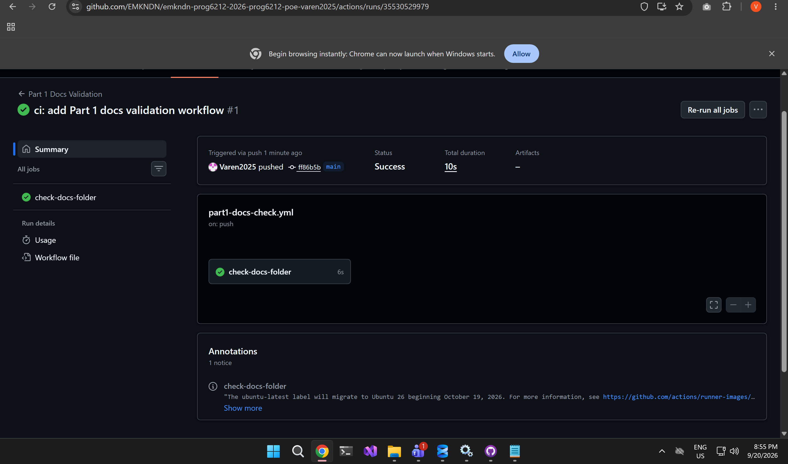
  <br>
  <em>
    Figure 2: Successful GitHub Actions Part 1 Docs Validation workflow. The green Success status confirms that the workflow executed correctly and validated the presence of the required /docs folder.
  </em>
</p>

The successful workflow confirms:

- The YAML workflow is valid.
- GitHub detected the workflow.
- Repository checkout completed.
- The validation job executed.
- The required `/docs` folder was located.
- The workflow completed with a green Success status.

---

## Assumptions

The following assumptions define the scope of Part 1.

- Part 1 is a planning and database-design submission.
- No ASP.NET Core API implementation is required during Part 1.
- No MVC application implementation is required during Part 1.
- Organiser and Participant accounts share one `USER` table.
- `ROLE_ID` identifies whether a User is an Organiser or Participant.
- Each Event belongs to one Organiser.
- Each Category belongs to one Event.
- Each Enrolment belongs to one Participant.
- Each Enrolment belongs to one Event.
- Each Enrolment selects one Category.
- A Participant may enrol only once in the same Event.
- An Enrolment can have a maximum of one Result.
- Image attributes store URLs rather than binary image content.
- Actual Blob Storage integration is deferred to Part 3.
- Authentication and role enforcement are planned in Part 1 but implemented in later stages.
- SHA2-256 is used only to create demonstration seed hashes.
- Final application passwords will use an appropriate application-level password-hashing approach.
- The SQL script is intentionally rerunnable for demonstration and testing.
- The exact local SQL Server instance name can vary between machines.

---

## Future Implementation

This section records the implementation roadmap documented during Part 1. For the Part 2 API implementation and its evidence, see the Part 2 sections below.

### Part 2

Part 2 should implement the ASP.NET Core Web API described by the Endpoint Plan.

Planned work includes:

- Registration.
- Login.
- Logout.
- Session handling.
- Role-based authorisation.
- User Profile operations.
- Event CRUD.
- Category CRUD.
- Participant Enrolment.
- Organiser Enrolment management.
- Result capture.
- Result update.
- Participant race-history retrieval.
- Entity Framework Core.
- SQL Server integration.
- Swagger/OpenAPI documentation.
- Unit testing.

---

### Part 3

Part 3 should implement the MVC web application that consumes the Part 2 API.

Planned functionality includes:

- Participant Event browsing.
- Event filtering.
- Event detail pages.
- Participant Enrolment.
- Participant profile management.
- Profile-picture upload.
- Organiser dashboard.
- Event management.
- Category management.
- Event banner upload.
- Enrolment management.
- Result management.
- Azure Blob Storage integration.

The Part 1 Endpoint Plan already includes the main API operations required to support these Part 3 requirements.

---

## Known Platform Considerations

### SQL Server instance names

SQL Server instance names differ between computers.

The development machine used SQL Express, but another computer may use a different Server Name.

---

### GitHub paths are case-sensitive

The repository uses:

```text
docs/Screenshots
```

with a capital `S`.

README image paths therefore use the same capitalisation.

---

### Filenames containing spaces

The repository contains filenames with spaces.

Within README links, spaces are encoded as:

```text
%20
```

For example:

```text
RaceDay SQL Execution Success ST10481447.png
```

is referenced as:

```text
RaceDay%20SQL%20Execution%20Success%20ST10481447.png
```

---

### SQL script reruns

The script drops the RaceDay Part 1 tables before rebuilding them when rerun.

This makes the demonstration repeatable, but any previous data in those tables will be removed.

---

### Password seed hashes

The SQL seed hashes are demonstration data only.

SHA-256 alone should not be used as the final production password-storage mechanism (OWASP Foundation, n.d.).

---

### API status during Part 1

The routes in the API Endpoint Plan are planned endpoints.

They are not live or deployed API endpoints during Part 1.


## Code Attributions

The following authoritative technical sources were consulted during the planning and implementation of Part 1.

These sources were used as references and were not copied as complete project solutions.

### SQL Server Table Creation

- **Usage:** `CREATE TABLE`, Identity columns, Primary Keys, Foreign Keys, `DEFAULT` definitions, and table-level constraints.
- **Author:** Microsoft
- **Source:** Microsoft Learn
- **Title:** `CREATE TABLE (Transact-SQL)`
- **Link:** https://learn.microsoft.com/en-us/sql/t-sql/statements/create-table-transact-sql
- **Date Accessed:** 22 September 2026

---

### SQL UNIQUE and CHECK Constraints

- **Usage:** Unique User emails, unique Role names, valid Event types, valid Category types, Enrolment status validation, distance validation, and finishing-position validation.
- **Author:** Microsoft
- **Source:** Microsoft Learn
- **Title:** `Unique constraints and check constraints`
- **Link:** https://learn.microsoft.com/en-us/sql/relational-databases/tables/unique-constraints-and-check-constraints
- **Date Accessed:** 22 September 2026

---

### SQL HASHBYTES

- **Usage:** Generating demonstration `SHA2_256` values for seeded User passwords.
- **Author:** Microsoft
- **Source:** Microsoft Learn
- **Title:** `HASHBYTES (Transact-SQL)`
- **Link:** https://learn.microsoft.com/en-us/sql/t-sql/functions/hashbytes-transact-sql
- **Date Accessed:** 22 September 2026

---

### GitHub Actions Workflow Syntax

- **Usage:** Workflow name, `push` trigger, jobs, runner, and step structure.
- **Author:** GitHub
- **Source:** GitHub Docs
- **Title:** `Workflow syntax for GitHub Actions`
- **Link:** https://docs.github.com/en/actions/reference/workflows-and-actions/workflow-syntax
- **Date Accessed:** 22 September 2026

---

### GitHub Checkout Action

- **Usage:** Making repository content available to the GitHub-hosted runner before validating `/docs`.
- **Author:** GitHub
- **Source:** GitHub
- **Title:** `Checkout`
- **Link:** https://github.com/actions/checkout
- **Date Accessed:** 22 September 2026

---

### REST Architectural Style

- **Usage:** Academic basis for resource-oriented REST API planning.
- **Author:** Roy Thomas Fielding
- **Source:** University of California, Irvine doctoral dissertation
- **Title:** `Architectural Styles and the Design of Network-based Software Architectures`
- **Date:** 2000
- **Link:** https://ics.uci.edu/~fielding/pubs/dissertation/abstract.htm
- **Date Accessed:** 22 September 2026

---

### HTTP Semantics

- **Usage:** Guidance on HTTP methods and response-status semantics.
- **Authors:** Roy Fielding, Mark Nottingham and Julian Reschke
- **Source:** Internet Engineering Task Force
- **Title:** `HTTP Semantics`
- **RFC:** RFC 9110
- **Date:** 2022
- **Link:** https://www.rfc-editor.org/rfc/rfc9110
- **Date Accessed:** 22 September 2026

---

### Password Storage

- **Usage:** Security guidance regarding production password hashing.
- **Author:** OWASP Foundation
- **Source:** OWASP Cheat Sheet Series
- **Title:** `Password Storage Cheat Sheet`
- **Link:** https://cheatsheetseries.owasp.org/cheatsheets/Password_Storage_Cheat_Sheet.html
- **Date Accessed:** 22 September 2026

---

## Part 1 Bibliography

Fielding, R.T., 2000. *Architectural Styles and the Design of Network-based Software Architectures*. Doctoral dissertation. University of California, Irvine. [online] Available at: <https://ics.uci.edu/~fielding/pubs/dissertation/abstract.htm> [Accessed 22 September 2026].

Fielding, R., Nottingham, M. and Reschke, J., 2022. *HTTP Semantics*. RFC 9110. Internet Engineering Task Force. [online] Available at: <https://www.rfc-editor.org/rfc/rfc9110> [Accessed 22 September 2026].

GitHub, n.d.-a. *Workflow syntax for GitHub Actions*. GitHub Docs. [online] Available at: <https://docs.github.com/en/actions/reference/workflows-and-actions/workflow-syntax> [Accessed 22 September 2026].

GitHub, n.d.-b. *Checkout*. [online] Available at: <https://github.com/actions/checkout> [Accessed 22 September 2026].

Microsoft, n.d.-a. *CREATE TABLE (Transact-SQL)*. Microsoft Learn. [online] Available at: <https://learn.microsoft.com/en-us/sql/t-sql/statements/create-table-transact-sql> [Accessed 22 September 2026].

Microsoft, n.d.-b. *Unique constraints and check constraints*. Microsoft Learn. [online] Available at: <https://learn.microsoft.com/en-us/sql/relational-databases/tables/unique-constraints-and-check-constraints> [Accessed 22 September 2026].

Microsoft, n.d.-c. *HASHBYTES (Transact-SQL)*. Microsoft Learn. [online] Available at: <https://learn.microsoft.com/en-us/sql/t-sql/functions/hashbytes-transact-sql> [Accessed 22 September 2026].

OWASP Foundation, n.d. *Password Storage Cheat Sheet*. OWASP Cheat Sheet Series. [online] Available at: <https://cheatsheetseries.owasp.org/cheatsheets/Password_Storage_Cheat_Sheet.html> [Accessed 22 September 2026].

---

## Contributor

<table>
  <tr>
    <td align="center">
      <strong>Varen Venketraju</strong>
      <br>
      <sub>ST10481447</sub>
      <br>
      <sub>PROG6212 - Programming 2B</sub>
    </td>
  </tr>
</table>

---

## Student Contribution in Detail

**Varen Venketraju (ST10481447)**

Responsible for the complete PROG6212 POE Part 1 RaceDay submission, including:

- Analysing the POE requirements.
- Reviewing the Part 1 rubric.
- Planning the RaceDay system.
- Designing the six-entity ERD.
- Defining Primary Keys.
- Defining Foreign Keys.
- Defining relationship verbs.
- Defining relationship direction.
- Defining cardinalities.
- Planning the RESTful API resources.
- Planning HTTP methods.
- Planning request routes.
- Planning request bodies.
- Planning success and failure responses.
- Including later Part 3 requirements in the Endpoint Plan.
- Creating the SQL Server database structure.
- Implementing database constraints.
- Creating realistic seed data.
- Testing the SQL script.
- Verifying seeded data in SQL Server Management Studio.
- Structuring the GitHub repository.
- Creating the `/docs` folder.
- Creating the GitHub Actions workflow.
- Testing the GitHub Actions workflow.
- Capturing SQL execution evidence.
- Capturing CI/CD evidence.
- Adding code attribution.
- Adding Harvard Anglia referencing.
- Creating the project README.
- Preparing the Part 1 demonstration video.

---

# Part 2 - RESTful API Implementation

---

## Part 2 Scope and Deliverables

Part 2 delivers the API back end of RaceDay. The MVC web application, Azure Blob Storage and Docker containerisation are delivered in [Part 3](#part-3---mvc-web-application-azure-blob-storage-and-docker), and the Part 1 plan already anticipated the endpoints that application needs.

| Deliverable | Location |
|---|---|
| ASP.NET Core Web API (C#) | `RaceDay.Api/` |
| EF Core models and `RaceDayDbContext` | `RaceDay.Api/Models/`, `RaceDay.Api/Data/RaceDayDbContext.cs` |
| EF Core Code-First migrations | `RaceDay.Api/Migrations/` |
| Controllers, DTOs and services | `RaceDay.Api/Controllers/`, `RaceDay.Api/DTOs/`, `RaceDay.Api/Services/` |
| MSTest unit and integration tests | `RaceDay.Api.Tests/` |
| GitHub Actions workflow (build and test) | [raceday-part2-ci.yml](.github/workflows/raceday-part2-ci.yml) |
| SQL database script | [RaceDay Database ST10481447.sql](docs/RaceDay%20Database%20ST10481447.sql) |
| Entity Relationship Diagram | [RaceDay ERD](docs/Race%20Day%20ERD%20-%20ST10481447%20PROG6212.pdf) |
| API Endpoint Plan | [RaceDay API Endpoint Plan](docs/PROG6212%20API%20Endpoint%20Plan%20-%20ST10481447.pdf) |
| Evidence screenshots | [Part 2 Evidence Index](#part-2-evidence-index) |
| Unlisted YouTube demonstration | [Part 2 Video Demonstration](#part-2-video-demonstration) |

---

## Part 2 Rubric Coverage

The Part 2 marking rubric totals 100 marks (The Independent Institute of Education, 2026). This table maps each criterion to the evidence in this repository.

| Criterion | Marks | Where It Is Addressed |
|---|---:|---|
| Correct Submission | 5 | This README, [setup and run guide](#part-2-setup-and-run-guide), [CI screenshot](#part-2-cicd-pipeline), [video link](#part-2-video-demonstration) |
| GitHub and CI/CD | 10 | `raceday-part2-ci.yml`, [CI/CD pipeline](#part-2-cicd-pipeline), `part-2-raceday-api` commit history |
| Authentication and Role-Based Access | 20 | [Roles](#part-2-roles), [Authentication and Security](#part-2-authentication-and-security) |
| API Endpoints and Database | 25 | [API Endpoints](#part-2-api-endpoints), [SQL Database and Script](#part-2-sql-database-and-script), EF Core migrations |
| Swagger Integration | 10 | [Swagger Verification](#part-2-swagger-verification) |
| Unit Testing | 15 | [Unit Testing](#part-2-unit-testing) |
| Video Presentation | 15 | [Part 2 Video Demonstration](#part-2-video-demonstration) |
| **Total** | **100** | |

---

## Part 2 Roles

RaceDay supports two distinct roles. Role-based access is enforced at the API level, not only by the user interface, so a request is rejected even if it is sent directly from Swagger or another client.

### Organiser

An Organiser manages events and everything attached to them. An Organiser can:

- Register, log in, log out, and view or update their own profile.
- Create, update and delete the events they own (name, description, date, location, distance and event type: run, walk or cycle).
- Define age-based and distance-based categories for their events (for example Under 20, Senior, 10km, 21km).
- View all enrolments for their events, including each Participant's selected category, and update enrolment status.
- Capture, update and publish finish times and finishing positions, and view the results of their events.

### Participant

A Participant uses RaceDay to find and enter events. A Participant can:

- Register, log in, log out, and view or update their own profile.
- Browse and filter upcoming events and view full event details.
- View the categories available for an event.
- Enrol in an event by selecting a category, which records the link between the Participant, the event and the category.
- View their own enrolments and enrolment status.
- View their own results and race history.

### Access rules

| Scenario | Expected Response |
|---|---|
| Public registration, login, event browsing and category browsing | Allowed without a session |
| Anonymous request to a protected endpoint | `401 Unauthorized` |
| Participant calls an Organiser-only endpoint | `403 Forbidden` |
| Organiser calls a Participant-only endpoint | `403 Forbidden` |
| Organiser changes an event, category, enrolment or result belonging to another Organiser | `403 Forbidden` |
| Duplicate registration email or duplicate enrolment | `409 Conflict` |

---

## Part 2 Architecture

<p align="center">
  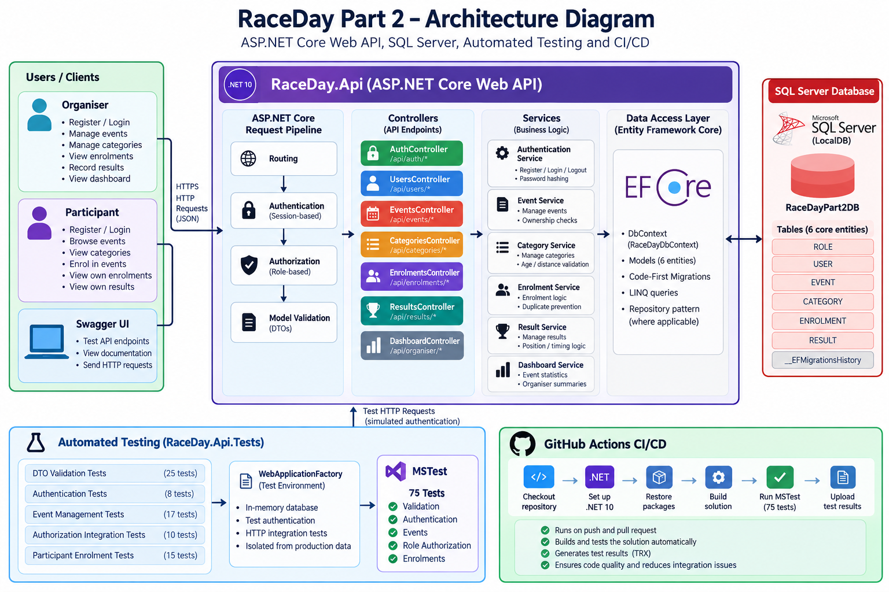
  <br>
  <em>Figure P2-1: RaceDay Part 2 architecture showing the request flow from Swagger or an HTTP client through the ASP.NET Core pipeline, controllers, services and EF Core to SQL Server, together with the MSTest and GitHub Actions paths.</em>
</p>

### API request flow

1. A client (Swagger UI or any HTTP client) sends a request to a `/api/...` route.
2. The ASP.NET Core pipeline matches the route, restores the user's session and applies authentication and authorisation (Microsoft, n.d.-d; Microsoft, n.d.-g).
3. The controller validates the request DTO and checks the caller's role and ownership of the target resource.
4. Supporting services, such as the password hasher, perform the required operation.
5. `RaceDayDbContext` uses Entity Framework Core to read or write SQL Server (Microsoft, n.d.-e).
6. The controller returns the data or a clear HTTP status code (`200`, `201`, `204`, `400`, `401`, `403`, `404` or `409`).

---

## Part 2 Technology Stack

| Technology | Use in Part 2 |
|---|---|
| C# and .NET 10 | Application language and framework |
| ASP.NET Core Web API | RESTful controllers, routing and middleware |
| Entity Framework Core | Code-First models, relationships, migrations and data access |
| Microsoft SQL Server LocalDB | Development database (`RaceDayPart2DB`) |
| ASP.NET Core session state | Stores the authenticated user ID and role between requests |
| ASP.NET Core Identity `PasswordHasher` | Salts, hashes and verifies passwords |
| Swagger / Swashbuckle | Interactive OpenAPI documentation and testing |
| MSTest | Unit and integration test framework |
| `WebApplicationFactory` | In-process HTTP integration tests |
| EF Core InMemory provider | Isolated databases for tests |
| Visual Studio 2026 | Development, migrations and Test Explorer |
| Git, GitHub and GitHub Desktop | Version control and submission |
| GitHub Actions | Continuous integration: restore, build and test |

---

## Part 2 Repository Structure

```text
emkndn-prog6212-2026-prog6212-poe-varen2025/
├── .github/
│   └── workflows/
│       ├── part1-docs-check.yml
│       └── raceday-part2-ci.yml
├── docs/
│   ├── Screenshots/
│   │   ├── Raceday-logo.png
│   │   ├── part1-ci-green-build.png
│   │   ├── RaceDay SQL Execution Success ST10481447.png
│   │   ├── part2-architecture-diagram.png
│   │   ├── part2-database-tables.png
│   │   ├── part2-swagger-endpoints.png
│   │   ├── part2-role-authorization.png
│   │   ├── part2-mstest-local.png
│   │   ├── part2-mstest-details.png
│   │   └── part2-ci-green-build.png
│   ├── Race Day ERD - ST10481447 PROG6212.pdf
│   ├── PROG6212 API Endpoint Plan - ST10481447.pdf
│   └── RaceDay Database ST10481447.sql
├── RaceDay.Api/
│   ├── Controllers/
│   ├── Data/
│   │   └── RaceDayDbContext.cs
│   ├── DTOs/
│   ├── Migrations/
│   ├── Models/
│   ├── Services/
│   ├── appsettings.json
│   ├── appsettings.Development.json
│   ├── Program.cs
│   └── RaceDay.Api.csproj
├── RaceDay.Api.Tests/
│   ├── RaceDayTestFactory.cs
│   ├── DtoValidationTests.cs
│   ├── AuthenticationTests.cs
│   ├── EventManagementTests.cs
│   ├── AuthorizationTests.cs
│   └── ParticipantEnrolmentTests.cs
└── README.md
```

---

## Part 2 Setup and Run Guide

Follow these numbered steps to clone, configure, run and test the API on a Windows computer.

### Prerequisites

- **Visual Studio 2026** with the **ASP.NET and web development** workload.
- **.NET 10 SDK**.
- **SQL Server LocalDB** (installed with Visual Studio) or another SQL Server instance.
- **Git** or **GitHub Desktop**, and internet access to restore NuGet packages.
- Optional: **SQL Server Management Studio (SSMS)** to run the SQL script.

### 1. Clone the repository

In GitHub Desktop choose **File > Clone repository > URL**, enter the repository URL below and select the `part-2-raceday-api` branch. Alternatively, use a terminal:

```bash
git clone -b part-2-raceday-api https://github.com/EMKNDN/emkndn-prog6212-2026-prog6212-poe-varen2025.git
cd emkndn-prog6212-2026-prog6212-poe-varen2025
```

### 2. Open the solution and restore packages

Open the solution file in Visual Studio and confirm that both **RaceDay.Api** and **RaceDay.Api.Tests** appear in Solution Explorer. Visual Studio restores the NuGet packages automatically; if not, choose **Build > Rebuild Solution**.

### 3. Set the connection string

Open `RaceDay.Api/appsettings.Development.json` and make sure it contains the following section (merge it with any existing settings rather than replacing the file). Change the server name if you are not using LocalDB.

```json
{
  "ConnectionStrings": {
    "RaceDayDatabase": "Server=(localdb)\\MSSQLLocalDB;Database=RaceDayPart2DB;Trusted_Connection=True;TrustServerCertificate=True;MultipleActiveResultSets=True"
  }
}
```

`Program.cs` reads `GetConnectionString("RaceDayDatabase")`, so the key name must match exactly. The connection uses Windows Authentication, so no password is stored in the repository.

### 4. Create the database

The API database is created by the Entity Framework Core Code-First migrations in `RaceDay.Api/Migrations/` (Microsoft, n.d.-f).

1. In Visual Studio open **Tools > NuGet Package Manager > Package Manager Console**.
2. Set **Default project** to `RaceDay.Api` and make sure `RaceDay.Api` is the startup project.
3. Run:

```powershell
Update-Database -Context RaceDayDbContext -Project RaceDay.Api -StartupProject RaceDay.Api -Args '--environment Development'
```

4. Wait for `Done.`, then open **View > SQL Server Object Explorer** and expand `(localdb)\MSSQLLocalDB > Databases > RaceDayPart2DB > Tables`. The six tables `ROLE`, `USER`, `EVENT`, `CATEGORY`, `ENROLMENT` and `RESULT` should be listed, together with `__EFMigrationsHistory`.

Terminal alternative, from the repository root:

```bash
dotnet tool install --global dotnet-ef
dotnet ef database update --project RaceDay.Api --startup-project RaceDay.Api -- --environment Development
```

The SQL script that defines the same schema and seed data is provided in [Part 2 SQL Database and Script](#part-2-sql-database-and-script).

### 5. Run the API

1. Right-click `RaceDay.Api` in Solution Explorer and choose **Set as Startup Project**.
2. Select the **https** launch profile in the toolbar.
3. Press **F5** (or the green Start button) and wait for the API to start listening.

Terminal alternative:

```bash
dotnet run --project RaceDay.Api --launch-profile https
```

### 6. Open Swagger

Browse to the Swagger UI on the HTTPS address shown by the launch profile, commonly:

```text
https://localhost:7226/swagger/index.html
```

The port can differ between computers; check `RaceDay.Api/Properties/launchSettings.json` for the actual address. Use **Try it out** and **Execute** to call endpoints. A suggested test sequence is given in [Part 2 Swagger Verification](#part-2-swagger-verification).

### 7. Run the unit tests

1. In Visual Studio open **Test > Test Explorer**.
2. Wait for the tests in `RaceDay.Api.Tests` to be discovered.
3. Click **Run All Tests**. All 75 tests should pass.

Terminal alternative, from the folder containing the solution file:

```bash
dotnet test --configuration Release
```

The tests use an isolated in-memory database, so they do not change `RaceDayPart2DB`. See [Part 2 Unit Testing](#part-2-unit-testing).

### Troubleshooting

| Problem | Likely cause and fix |
|---|---|
| `Update-Database` cannot connect | LocalDB is not installed or the server name differs. Update `RaceDayDatabase` in `appsettings.Development.json`. |
| Swagger page does not open | The port differs. Read the HTTPS URL from `launchSettings.json` and append `/swagger/index.html`. |
| Browser shows an HTTPS certificate warning | Trust the .NET development certificate with `dotnet dev-certs https --trust`. |
| `401 Unauthorized` in Swagger | You are not logged in. Call `POST /api/auth/login` first, in the same browser session. |
| `403 Forbidden` in Swagger | The logged-in role is not allowed to call that endpoint, or the resource belongs to another Organiser. |

---

## Part 2 SQL Database and Script

The SQL script is provided in the `docs` folder and is the same script submitted for Part 1. It is written for SQL Server and SSMS and defines the full RaceDay schema and realistic seed data.

| SQL resource | Database | Purpose | Link |
|---|---|---|---|
| **SQL database script** | `RaceDayDB` | Creates all six tables with primary keys, foreign keys, `NOT NULL`, `UNIQUE`, `DEFAULT` and `CHECK` constraints, inserts seed data and runs verification queries | [RaceDay Database ST10481447.sql](docs/RaceDay%20Database%20ST10481447.sql) |
| **EF Core migrations** | `RaceDayPart2DB` | Creates the same six-entity schema for the running API using Code-First mapping | `RaceDay.Api/Migrations/` |

### Running the SQL script in SSMS

1. Open SQL Server Management Studio and connect to your instance (for example `(localdb)\MSSQLLocalDB` or `.\SQLEXPRESS`).
2. Open `docs/RaceDay Database ST10481447.sql`.
3. Execute the complete script (**F5**).
4. Refresh **Databases** and expand `RaceDayDB > Tables` to confirm the six tables.
5. Review the verification result sets at the end of the script.

The script drops and recreates the Part 1 tables each time it is run, so **do not run it against `RaceDayPart2DB`**. It creates its own database, `RaceDayDB`, which is kept separate from the database used by the running API.

### Database design

The API model keeps the six entities from the Part 1 ERD: `ROLE`, `USER`, `EVENT`, `CATEGORY`, `ENROLMENT` and `RESULT`. The relationships are Role to User, Organiser to Event, Event to Category, Participant to Enrolment, Event to Enrolment, Category to Enrolment and Enrolment to Result, configured in `RaceDayDbContext.cs`. The full ERD, entity detail and constraint explanations are in the [Part 1 documentation](#entity-relationship-diagram).

### Seed data

| Data Type | Records |
|---|---:|
| Roles | 2 |
| Organisers | 2 |
| Participants | 2 |
| Events | 3 |
| Categories | 6 |
| Enrolments | 3 |
| Results | 2 |

The seed passwords in the SQL script are demonstration SHA-256 hashes created with `HASHBYTES`. The API verifies passwords with the ASP.NET Core Identity password hasher, so use **newly registered accounts** to log in to the running API.

<p align="center">
  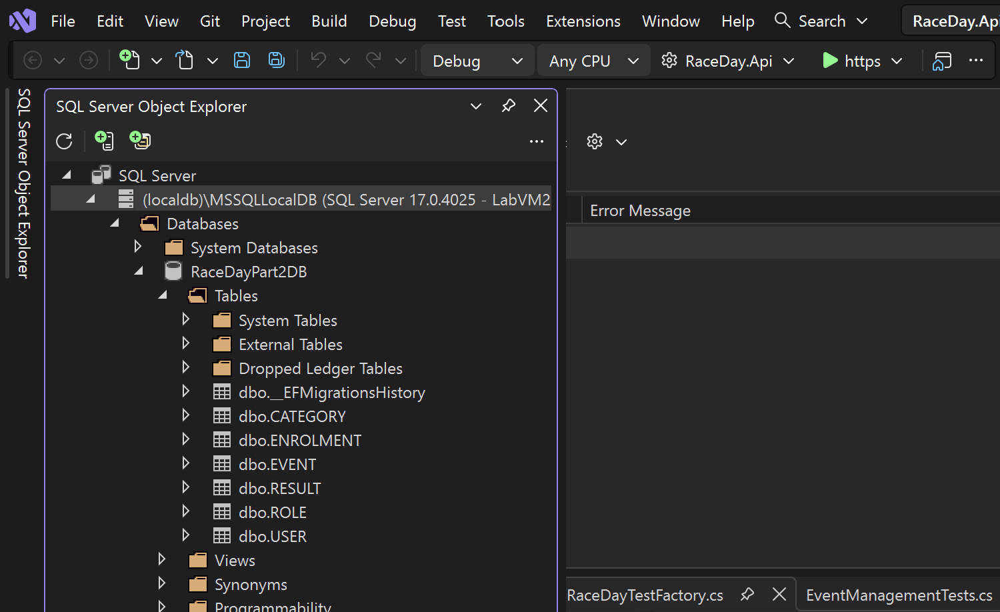
  <br>
  <em>Figure P2-2: RaceDayPart2DB created through EF Core Code-First migrations, showing the six RaceDay tables and the migrations history table.</em>
</p>

---

## Part 2 API Endpoints

The API implements the endpoints defined in the Part 1 [API Endpoint Plan](docs/PROG6212%20API%20Endpoint%20Plan%20-%20ST10481447.pdf). Every endpoint is visible and testable in Swagger. **Role** uses the same terms as the plan: *None* is public, *Any* is any logged-in user.

### Authentication

| Method | Route | Role | Request Body | Responses |
|---|---|---|---|---|
| POST | `/api/auth/register` | None | `{ firstName, lastName, email, password, phoneNumber, dateOfBirth, role }` | `201` created, `400` invalid data, `409` email already registered |
| POST | `/api/auth/login` | None | `{ email, password }` | `200` logged in, `401` incorrect credentials |
| POST | `/api/auth/logout` | Any | None | `204` logged out, `401` not logged in |

### User profile

| Method | Route | Role | Request Body | Responses |
|---|---|---|---|---|
| GET | `/api/users/me` | Any | None | `200` profile, `401` |
| PUT | `/api/users/me` | Any | `{ firstName, lastName, phoneNumber, dateOfBirth }` | `200` updated, `400`, `401` |

### Events

| Method | Route | Role | Request Body | Responses |
|---|---|---|---|---|
| GET | `/api/events` | None | None (optional filters: event type, location, date) | `200` event list |
| GET | `/api/events/{id}` | None | None | `200` event, `404` |
| GET | `/api/events/mine` | Organiser | None | `200` own events, `401`, `403` |
| POST | `/api/events` | Organiser | `{ name, description, eventDate, location, distanceKm, eventType }` | `201` created, `400`, `401`, `403` |
| PUT | `/api/events/{id}` | Organiser (owner) | `{ name, description, eventDate, location, distanceKm, eventType }` | `200` updated, `400`, `401`, `403`, `404` |
| DELETE | `/api/events/{id}` | Organiser (owner) | None | `204` deleted, `401`, `403`, `404` |

### Categories

| Method | Route | Role | Request Body | Responses |
|---|---|---|---|---|
| GET | `/api/events/{eventId}/categories` | None | None | `200` categories, `404` |
| GET | `/api/categories/{id}` | None | None | `200` category, `404` |
| POST | `/api/events/{eventId}/categories` | Organiser (owner) | `{ categoryName, categoryType, minAge, maxAge, distanceKm }` | `201` created, `400`, `401`, `403`, `404` |
| PUT | `/api/categories/{id}` | Organiser (owner) | `{ categoryName, categoryType, minAge, maxAge, distanceKm }` | `200` updated, `400`, `401`, `403`, `404` |
| DELETE | `/api/categories/{id}` | Organiser (owner) | None | `204` deleted, `401`, `403`, `404`, `409` category in use |

### Event enrolments

| Method | Route | Role | Request Body | Responses |
|---|---|---|---|---|
| POST | `/api/enrolments` | Participant | `{ eventId, categoryId }` | `201` enrolled, `400` invalid event/category, `401`, `403`, `404`, `409` already enrolled |
| GET | `/api/enrolments/me` | Participant | None | `200` own enrolments, `401`, `403` |
| GET | `/api/events/{eventId}/enrolments` | Organiser (owner) | None | `200` enrolments, `401`, `403`, `404` |
| PUT | `/api/enrolments/{id}/status` | Organiser (owner) | `{ status }` | `200` updated, `400`, `401`, `403`, `404` |

### Results

| Method | Route | Role | Request Body | Responses |
|---|---|---|---|---|
| POST | `/api/results` | Organiser (owner) | `{ enrolmentId, finishTime, finishingPosition, isPublished }` | `201` recorded, `400`, `401`, `403`, `404`, `409` result already exists |
| PUT | `/api/results/{id}` | Organiser (owner) | `{ finishTime, finishingPosition, isPublished }` | `200` updated, `400`, `401`, `403`, `404` |
| GET | `/api/events/{eventId}/results` | Organiser (owner) | None | `200` event results, `401`, `403`, `404` |
| GET | `/api/results/me` | Participant | None | `200` own results, `401`, `403` |

### Part 3 support endpoints

Profile-image upload, event-banner upload and the Organiser dashboard summary depend on Azure Blob Storage and the MVC dashboard, which are delivered in Part 3 (see [Part 3](#part-3---mvc-web-application-azure-blob-storage-and-docker)). They are therefore not part of the Part 2 assessed API.

---

## Part 2 Authentication and Security

- **Registration:** a user supplies personal details, an email, a password and a role of `Organiser` or `Participant`. Duplicate emails are rejected with `409 Conflict`.
- **Password hashing:** passwords are salted and hashed with the ASP.NET Core Identity `PasswordHasher` and only the hash is stored, never the original password (Microsoft, n.d.-h; OWASP Foundation, n.d.).
- **Session management:** after a successful login the API stores the user's ID and role in server-side session state, which is used on every later request until logout (Microsoft, n.d.-g).
- **Protected endpoints:** endpoints outside the public set return `401 Unauthorized` when there is no authenticated session.
- **Role enforcement:** Organiser endpoints reject Participants and Participant endpoints reject Organisers with `403 Forbidden`.
- **Ownership:** an Organiser can only change events, categories, enrolments and results that belong to their own events.
- **Validation:** request DTOs reject missing, unsupported or inconsistent values, returning `400`, `404` or `409` as appropriate, instead of raw server errors.
- **Secrets:** the connection string uses Windows Authentication, so no passwords or secrets are committed.

The HTTP integration tests use a test-only authentication handler to simulate Organiser, Participant and anonymous callers. The live session login and logout flow is demonstrated separately in Swagger and in the video.

---

## Part 2 Swagger Verification

Swagger UI is enabled in the Development environment and lists every endpoint grouped by resource (Auth, Users, Events, Categories, Enrolments and Results). Each endpoint shows its purpose, the request body it expects and the responses it returns (Microsoft, n.d.-i).

### Manual verification sequence

1. Register one Participant and one Organiser and confirm `201 Created`.
2. Register the same email again and confirm `409 Conflict`.
3. Log in with correct and incorrect credentials and confirm `200` and `401`.
4. Browse public events and categories without logging in.
5. As the Organiser, create an event and a category and confirm they appear in SQL Server.
6. As the Participant, enrol in the event with a category and confirm the enrolment is recorded as `Pending`.
7. Attempt a duplicate enrolment and an invalid event/category combination and confirm the failure responses.
8. As the event owner, update the enrolment status and capture a result.
9. As the Participant, call an Organiser-only endpoint and confirm `403 Forbidden`.
10. Log out and repeat a protected request to confirm `401 Unauthorized`.

<p align="center">
  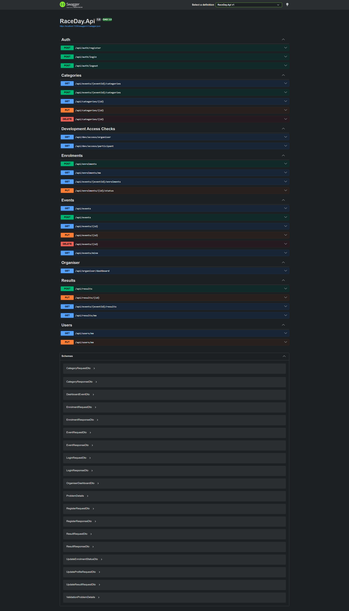
  <br>
  <em>Figure P2-3: Swagger UI documenting the RaceDay Part 2 API resources and endpoints.</em>
</p>

<p align="center">
  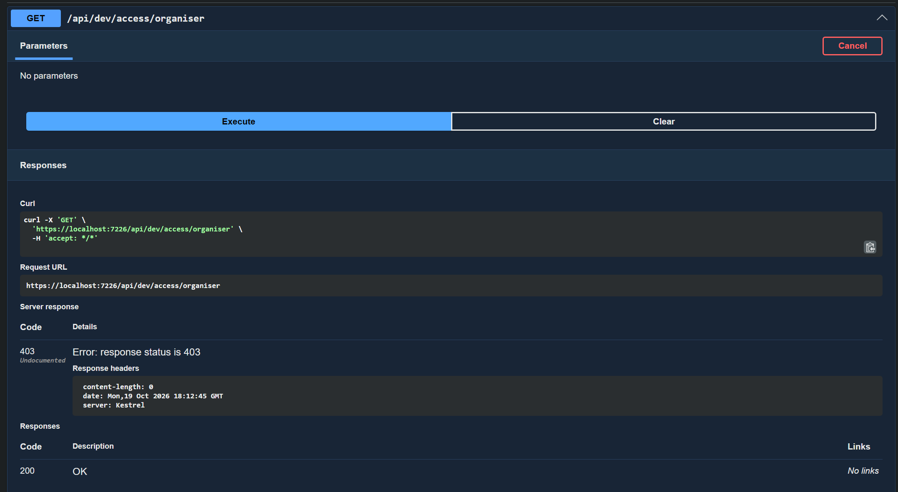
  <br>
  <em>Figure P2-4: Role-based access enforced by the API, shown by a rejected request to a protected endpoint.</em>
</p>

---

## Part 2 Unit Testing

The tests are written with MSTest using the Arrange, Act, Assert pattern (Microsoft, n.d.-j). Service-level tests check logic and validation, and HTTP integration tests use `WebApplicationFactory` to call the real routes and middleware (Microsoft, n.d.-k). Each area covers both expected success and expected failure, for authenticated and unauthenticated requests.

| Test class | Tests | Main coverage |
|---|---:|---|
| `DtoValidationTests.cs` | 25 | Event, category, enrolment, result and profile request validation |
| `AuthenticationTests.cs` | 8 | Registration, duplicate email, login, wrong password, password hashing and salting |
| `EventManagementTests.cs` | 17 | Organiser event CRUD, filtering, missing records, ownership and event attributes |
| `AuthorizationTests.cs` | 10 | Anonymous `401`, wrong role `403`, Organiser access and public endpoints |
| `ParticipantEnrolmentTests.cs` | 15 | Enrolment creation, duplicates, category eligibility, persistence and ownership |
| **Total** | **75** | |

### Running the tests

```bash
dotnet test --configuration Release
```

Or use **Test > Test Explorer > Run All Tests** in Visual Studio.

<p align="center">
  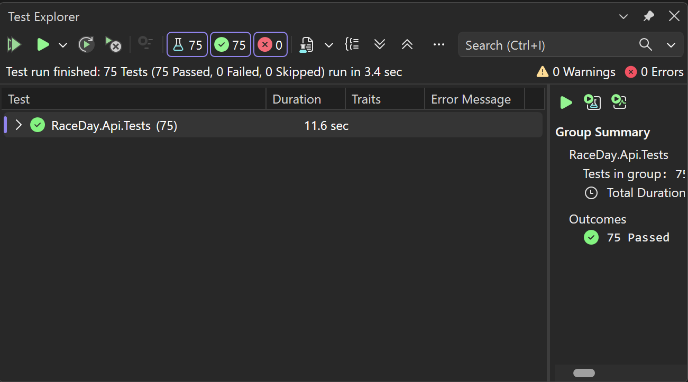
  <br>
  <em>Figure P2-5: Successful local MSTest run in Visual Studio Test Explorer covering validation, authentication, events, role access and Participant enrolments.</em>
</p>

<p align="center">
  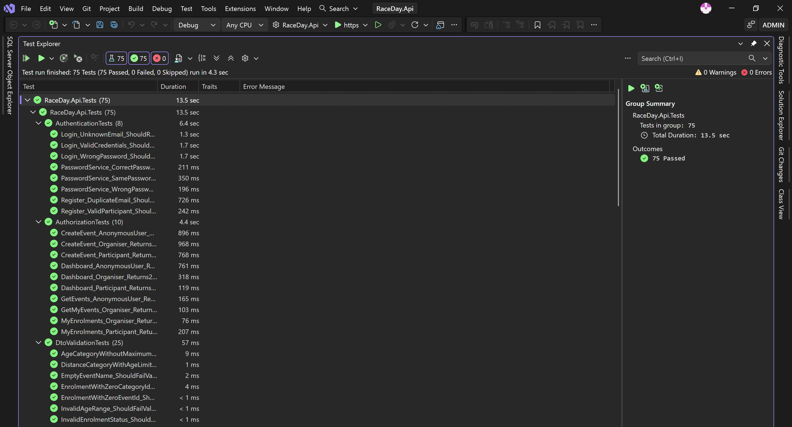
  <br>
  <em>Figure P2-6: Individual test cases demonstrating positive and negative API scenarios.</em>
</p>

> **Testing note:** the tests use the EF Core InMemory provider, which does not enforce SQL Server foreign keys. Database behaviour is therefore also verified through the SQL Server database and the live Swagger walkthrough.

---

## Part 2 CI/CD Pipeline

The GitHub Actions workflow is stored at [`.github/workflows/raceday-part2-ci.yml`](.github/workflows/raceday-part2-ci.yml) and is named **RaceDay Part 2 CI**. It runs on every push and pull request and builds the project and runs all unit tests (GitHub, n.d.-c).

| Step | Purpose |
|---|---|
| Checkout repository | Obtain the committed source on a clean runner |
| Set up .NET 10 | Use the same SDK major version as the API |
| Validate structure | Confirm the solution, test project and README exist |
| Restore NuGet packages | Download declared dependencies |
| Build solution | Compile the API and test project in Release configuration |
| Run MSTest suite | Run all discovered tests |
| Upload test results | Keep the `.trx` results as a workflow artifact |

The workflow completes with a green **Build and Test RaceDay API** job, and the log reports **75 passed, 0 failed**.

<p align="center">
  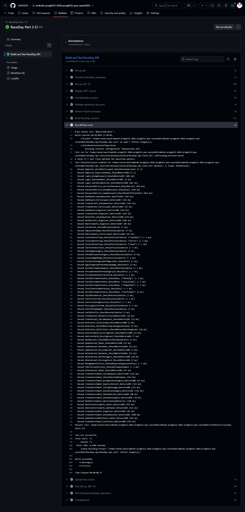
  <br>
  <em>Figure P2-7: Successful GitHub Actions run restoring, building and testing the RaceDay API, with all 75 tests passing.</em>
</p>

### Version control

Part 2 work was committed to the `part-2-raceday-api` branch from my own GitHub account, with commits for the models, `DbContext`, migrations, DTOs, controllers, authentication, tests, workflow and documentation.

---

## Part 2 Evidence Index

| Figure | Evidence | File |
|---|---|---|
| P2-1 | Architecture diagram | `docs/Screenshots/part2-architecture-diagram.png` |
| P2-2 | `RaceDayPart2DB` tables in SQL Server Object Explorer | `docs/Screenshots/part2-database-tables.png` |
| P2-3 | Swagger UI endpoint list | `docs/Screenshots/part2-swagger-endpoints.png` |
| P2-4 | Role-based rejection (`403` or `401`) | `docs/Screenshots/part2-role-authorization.png` |
| P2-5 | Local MSTest run, all passing | `docs/Screenshots/part2-mstest-local.png` |
| P2-6 | Expanded Test Explorer with test names | `docs/Screenshots/part2-mstest-details.png` |
| P2-7 | Green GitHub Actions build | `docs/Screenshots/part2-ci-green-build.png` |

> Image paths are case-sensitive on GitHub. The folder is `docs/Screenshots` with a capital `S`.

---

## Part 2 Video Demonstration

<p align="center">
  <a href="https://youtu.be/-S8MC3IVvxw">
    
  </a>
</p>

**Unlisted YouTube link:** https://youtu.be/-S8MC3IVvxw

The video demonstrates the running API with the student's own voice-over and covers:

1. The RaceDay system and the Part 2 scope.
2. The solution structure: Controllers, DTOs, Models, Services, `RaceDayDbContext` and Migrations.
3. The SQL Server database and its six tables.
4. Swagger, with each endpoint's request body and responses.
5. Registration and login for both roles, and role restrictions (`401` and `403`).
6. Event creation, category management, Participant enrolment and results.
7. The unit tests running locally, with examples of success and failure cases.
8. The green GitHub Actions build.
9. How Part 2 supports the Part 3 MVC application.

---

## Part 2 Code Attribution

The RaceDay source files contain explanatory comments and attribution blocks where official documentation informed the implementation. These sources were used as references and were not copied as complete solutions.

| Area | Source and use |
|---|---|
| ASP.NET Core Web API | Microsoft, *Create web APIs with ASP.NET Core* - controllers, routing and HTTP responses |
| EF Core DbContext | Microsoft, *DbContext configuration* - context setup and dependency injection |
| EF Core migrations | Microsoft, *Managing Migrations* - Code-First schema creation |
| Session state | Microsoft, *Session and state management in ASP.NET Core* - storing the user ID and role |
| Password hashing | Microsoft, *PasswordHasher Class* - salted password hashes and verification |
| Swagger / OpenAPI | Microsoft, *OpenAPI support in ASP.NET Core API apps* - interactive API documentation |
| MSTest | Microsoft, *Unit testing C# with MSTest* - test structure and assertions |
| Integration tests | Microsoft, *Integration tests in ASP.NET Core* - `WebApplicationFactory` test setup |
| GitHub Actions | GitHub, *Building and testing .NET* - build and test workflow |
| Password storage | OWASP Foundation, *Password Storage Cheat Sheet* - password-hashing guidance |

---

## Part 2 Bibliography

GitHub, n.d.-c. *Building and testing .NET*. GitHub Docs. [online] Available at: <https://docs.github.com/en/actions/tutorials/build-and-test-code/net> [Accessed 19 October 2026].

The Independent Institute of Education, 2026. *PROG6212 Programming 2B: Portfolio of Evidence Brief and Marking Rubrics*. [unpublished assignment brief]. The Independent Institute of Education (Pty) Ltd.

Microsoft, n.d.-d. *Create web APIs with ASP.NET Core*. Microsoft Learn. [online] Available at: <https://learn.microsoft.com/en-us/aspnet/core/web-api/> [Accessed 19 October 2026].

Microsoft, n.d.-e. *DbContext configuration*. Microsoft Learn. [online] Available at: <https://learn.microsoft.com/en-us/ef/core/dbcontext-configuration/> [Accessed 19 October 2026].

Microsoft, n.d.-f. *Managing Migrations*. Microsoft Learn. [online] Available at: <https://learn.microsoft.com/en-us/ef/core/managing-schemas/migrations/> [Accessed 19 October 2026].

Microsoft, n.d.-g. *Session and state management in ASP.NET Core*. Microsoft Learn. [online] Available at: <https://learn.microsoft.com/en-us/aspnet/core/fundamentals/app-state> [Accessed 19 October 2026].

Microsoft, n.d.-h. *PasswordHasher<TUser> Class*. Microsoft Learn. [online] Available at: <https://learn.microsoft.com/en-us/dotnet/api/microsoft.aspnetcore.identity.passwordhasher-1> [Accessed 19 October 2026].

Microsoft, n.d.-i. *OpenAPI support in ASP.NET Core API apps*. Microsoft Learn. [online] Available at: <https://learn.microsoft.com/en-us/aspnet/core/fundamentals/openapi/overview> [Accessed 19 October 2026].

Microsoft, n.d.-j. *Unit testing C# with MSTest*. Microsoft Learn. [online] Available at: <https://learn.microsoft.com/en-us/dotnet/core/testing/unit-testing-mstest-intro> [Accessed 19 October 2026].

Microsoft, n.d.-k. *Integration tests in ASP.NET Core*. Microsoft Learn. [online] Available at: <https://learn.microsoft.com/en-us/aspnet/core/test/integration-tests> [Accessed 19 October 2026].

OWASP Foundation, n.d. *Password Storage Cheat Sheet*. OWASP Cheat Sheet Series. [online] Available at: <https://cheatsheetseries.owasp.org/cheatsheets/Password_Storage_Cheat_Sheet.html> [Accessed 19 October 2026].

The Part 1 reference list, which uses `n.d.-a` to `n.d.-c` for Microsoft and `n.d.-a` and `n.d.-b` for GitHub, is in the [Part 1 Bibliography](#part-1-bibliography).


---

# Part 3 - MVC Web Application, Azure Blob Storage and Docker

---

## Part 3 Scope and Deliverables

Part 3 delivers the RaceDay web front end. An ASP.NET Core MVC application consumes the Part 2 API for every data operation, Azure Blob Storage is integrated into the API for image uploads, and the MVC application is containerised with Docker. The MVC project contains no database access and does not talk to Azure; every request goes through the API.

| Deliverable | Location |
|---|---|
| ASP.NET Core MVC web application | `RaceDay.Web/` |
| Controllers, filters, view models and API client | `RaceDay.Web/Controllers/`, `RaceDay.Web/Filters/`, `RaceDay.Web/Models/`, `RaceDay.Web/Services/` |
| Razor views and shared layout | `RaceDay.Web/Views/` |
| Global style sheet and images | `RaceDay.Web/wwwroot/css/site.css`, `RaceDay.Web/wwwroot/images/` |
| Azure Blob Storage service (inside the API) | `RaceDay.Api/Services/BlobStorageService.cs`, `IBlobStorageService.cs`, `ImageUploadValidator.cs` |
| Image upload endpoints (inside the API) | `POST /api/events/{id}/banner`, `POST /api/users/me/profile-image` |
| Dockerfile | `RaceDay.Web/Dockerfile` |
| GitHub Actions workflow (API and MVC build) | [raceday-part2-ci.yml](.github/workflows/raceday-part2-ci.yml) |
| Evidence screenshots | [Part 3 Evidence Index](#part-3-evidence-index) |
| Unlisted YouTube demonstration | [Part 3 Video Demonstration](#part-3-video-demonstration) |

**Part 3 branch:** `part-3-raceday-mvc`

---

## Part 3 Rubric Coverage

The Part 3 marking rubric totals 100 marks (The Independent Institute of Education, 2026). This table maps each criterion to the evidence in this repository.

| Criterion | Marks | Where It Is Addressed |
|---|---:|---|
| Correct Submission | 5 | This README, [setup and run guide](#part-3-setup-and-run-guide), [Docker instructions](#part-3-docker), [CI screenshot](#part-3-cicd-pipeline), [video link](#part-3-video-demonstration) |
| GitHub and CI/CD | 10 | [CI/CD pipeline](#part-3-cicd-pipeline), `part-3-raceday-mvc` commit history |
| Authentication and Role-Based Navigation | 10 | [Authentication and Role-Based Navigation](#part-3-authentication-and-role-based-navigation) |
| Organiser Interface | 15 | [Organiser Interface](#part-3-organiser-interface) |
| Participant Interface | 15 | [Participant Interface](#part-3-participant-interface) |
| Azure Blob Storage | 10 | [Azure Blob Storage](#part-3-azure-blob-storage) |
| Docker | 10 | [Docker](#part-3-docker) |
| UI Design | 10 | [UI Design](#part-3-ui-design) |
| Video Presentation | 15 | [Part 3 Video Demonstration](#part-3-video-demonstration) |
| **Total** | **100** | |

---

## Part 3 Roles

The two roles from Part 1 and Part 2 are carried through the MVC application. The API still enforces access on every protected endpoint, and the MVC application reflects the same rules in its navigation and pages.

| Role | What they see and do in the MVC application |
|---|---|
| **Organiser** | Organiser menu (Home, Events, Organiser Dashboard, My Profile). Dashboard summary, create, edit and delete events with a banner image, manage categories, view enrolments and their status, and capture and publish results. |
| **Participant** | Participant menu (Home, Events, My Races, My Profile). Browse and filter events, view event details and categories, enrol with a category, view their enrolments and status, view their race results, and manage their profile and profile picture. |
| **Visitor (not logged in)** | Home page and event browsing only, with Register and Log in options. Protected pages redirect to the login page. |

---

## Part 3 Architecture

```text
                      RACEDAY PART 3

   Browser
      │   HTTPS / HTTP (port 8080 in Docker)
      ▼
┌─────────────────────────────┐
│ RaceDay.Web (ASP.NET MVC)   │   Razor views, controllers, session,
│ No database, no Azure code  │   role filter, typed API client
└──────────────┬──────────────┘
               │ HTTPS + the user's API session cookie
               ▼
┌─────────────────────────────┐
│ RaceDay.Api (Part 2 API)    │   Auth, roles, validation, business rules
└───────┬───────────────┬─────┘
        │ EF Core       │ Azure Blob Storage SDK
        ▼               ▼
┌──────────────┐  ┌───────────────────────────┐
│ SQL Server   │  │ Azure Blob Storage        │
│ RaceDayPart2DB│ │ event banners, profile    │
└──────────────┘  │ pictures (URL kept in SQL)│
                  └───────────────────────────┘
```

### Request flow

1. The user opens a page in the MVC application. The `RequireRole` filter checks the session for the logged-in user and role, and redirects to the login page or the Access Denied page when needed (Microsoft, n.d.-m).
2. The controller calls `IRaceDayApiClient`, the only class that talks to the API. It is registered as a typed `HttpClient` (Microsoft, n.d.-l).
3. A message handler forwards the user's own API session cookie, so the API sees the same authenticated user and role. Cookies are never shared between users.
4. The API validates the request, enforces role and ownership rules, and reads or writes SQL Server through EF Core.
5. The client turns every outcome into an `ApiResult` with a friendly message, so the user never sees a raw error or stack trace.
6. The controller returns a view, or redirects with a success or error message.

---

## Part 3 Technology Stack

| Technology | Use in Part 3 |
|---|---|
| ASP.NET Core MVC (.NET 10) | Controllers, Razor views, tag helpers and filters |
| `IHttpClientFactory` typed client | All communication with the RaceDay API |
| ASP.NET Core session state | Stores the user ID, role and API session between pages |
| Bootstrap 5.3 | Layout, grid, navbar, carousel and responsive behaviour |
| Custom `site.css` | RaceDay brand theme, typography, cards, banners and status colours |
| Barlow and Barlow Condensed (Google Fonts) | Sporting, energetic typography |
| Unsplash photography | Carousel, page banners and event placeholders |
| jQuery Validation and unobtrusive validation | Client-side form validation |
| Azure Blob Storage SDK (`Azure.Storage.Blobs`) | Image storage inside the API |
| Docker | Containerising the MVC application |
| GitHub Actions | Building the API and the MVC project on every push |

---

## Part 3 Repository Structure

```text
emkndn-prog6212-2026-prog6212-poe-varen2025/
├── .github/workflows/
│   ├── part1-docs-check.yml
│   └── raceday-part2-ci.yml            (builds and tests the API, builds the MVC project)
├── docs/
├── RaceDay.Api/
│   ├── Controllers/                    (events, users and other endpoints, including image uploads)
│   └── Services/
│       ├── BlobStorageService.cs       (Azure Blob upload)
│       ├── IBlobStorageService.cs
│       └── ImageUploadValidator.cs     (size and file-signature check)
├── RaceDay.Api.Tests/
├── RaceDay.Web/
│   ├── Controllers/                    (Account, Home, Events, Organiser*, Participant, Profile, Access)
│   ├── Dtos/
│   ├── Filters/                        (RequireRole)
│   ├── Models/                         (view models)
│   ├── Services/                       (API client, ApiResult, image rules, status rules, session keys)
│   ├── Views/
│   │   ├── Shared/                     (_Layout, _RoleNav, _EventCard, validation scripts)
│   │   ├── Home/  Events/  Account/  Profile/  Access/
│   │   ├── Organiser/  OrganiserEvents/  OrganiserCategories/
│   │   ├── OrganiserEnrolments/  OrganiserResults/
│   │   └── Participant/
│   ├── wwwroot/
│   │   ├── css/site.css                (single global style sheet)
│   │   └── images/                     (local photography)
│   ├── Dockerfile
│   ├── Program.cs
│   └── appsettings.json
└── README.md
```

---

## Part 3 Setup and Run Guide

Follow these steps to run the complete system locally. The MVC application needs the API running first.

### Prerequisites

- **Visual Studio 2026** with the **ASP.NET and web development** workload, or the **.NET 10 SDK**.
- **SQL Server LocalDB** (the Part 2 database is `RaceDayPart2DB`).
- An **Azure Storage account** with a Blob container, for image uploads.
- **Docker Desktop**, only for the Docker steps.

### 1. Clone the repository

```bash
git clone -b part-3-raceday-mvc https://github.com/EMKNDN/emkndn-prog6212-2026-prog6212-poe-varen2025.git
cd emkndn-prog6212-2026-prog6212-poe-varen2025
```

### 2. Create the database

Follow [Part 2 Setup and Run Guide](#part-2-setup-and-run-guide) steps 3 and 4 to set the connection string and run `Update-Database`.

### 3. Configure Azure Blob Storage for the API

Create a Storage account and a Blob container in the Azure portal. Set the container's access level so that blobs can be read publicly, because the API stores each image's public URL in the database and the browser loads it directly.

The connection string is a secret and is **never committed to GitHub**. Store it with .NET user secrets (Microsoft, n.d.-s):

```bash
dotnet user-secrets init --project RaceDay.Api
dotnet user-secrets set "BlobStorage:ConnectionString" "<your-storage-connection-string>" --project RaceDay.Api
dotnet user-secrets set "BlobStorage:ContainerName" "<your-container-name>" --project RaceDay.Api
```

When the API runs in another place, such as a container, supply the same values as the environment variables `BlobStorage__ConnectionString` and `BlobStorage__ContainerName`.

### 4. Run the API

```bash
dotnet run --project RaceDay.Api --launch-profile https
```

Confirm Swagger opens at `https://localhost:7226/swagger/index.html`. The port can differ; check `RaceDay.Api/Properties/launchSettings.json`.

### 5. Point the MVC application at the API

`RaceDay.Web/appsettings.json` contains:

```json
"RaceDayApi": {
  "BaseUrl": "https://localhost:7226/",
  "AllowInvalidCertificate": false
}
```

Change `BaseUrl` if the API uses a different address. Leave `AllowInvalidCertificate` as `false` when running locally.

### 6. Run the MVC application

In Visual Studio set `RaceDay.Web` as the startup project and press **F5**, or run:

```bash
dotnet run --project RaceDay.Web
```

### 7. Create test accounts

The seed passwords in the SQL script are demonstration hashes, so use the **Register** page to create accounts. Register one Organiser and one Participant, then follow the [demo walkthrough](#part-3-demo-walkthrough).

### Troubleshooting

| Problem | Likely cause and fix |
|---|---|
| "The RaceDay service is currently unavailable" | The API is not running, or `RaceDayApi:BaseUrl` is wrong. Start the API and check the address. |
| Browser shows an HTTPS certificate warning | Run `dotnet dev-certs https --trust`. |
| Banner or picture says only JPG, PNG or WebP are allowed | The file must be a real JPG, PNG or WebP image, up to 2 MB. Renaming another format (GIF, BMP, AVIF, HEIC) does not work. |
| Image is uploaded but does not display | The Blob container does not allow public blob read access. |
| "Your session has expired" | The session timed out after 20 idle minutes. Log in again. |

---

## Part 3 Authentication and Role-Based Navigation

- **Register and log in:** both pages post to the API through the typed client. The API validates the data, hashes the password and creates its session.
- **Session:** after login, the MVC application stores the user ID, the role and the API session cookie in server-side session state, so the authenticated state and role are available on every page (Microsoft, n.d.-g). The MVC session expires after 20 idle minutes, which is shorter than the API session, so MVC always expires first.
- **Role-based interface:** `_RoleNav` shows a different menu for Organisers, Participants and visitors, and highlights the current page.
- **Protected pages:** the `RequireRole` filter sends unauthenticated visitors to the login page and sends users with the wrong role to the Access Denied page. The API enforces the same rules again, so a direct request is rejected too.
- **Expired API session:** if the API no longer accepts the session, the MVC session is cleared and the user is asked to log in again.
- **Log out:** ends the API session, clears the MVC session and redirects to the home page.
- **Anti-forgery:** every create, edit and delete form posts with an anti-forgery token (Microsoft, n.d.-o).

<p align="center">
  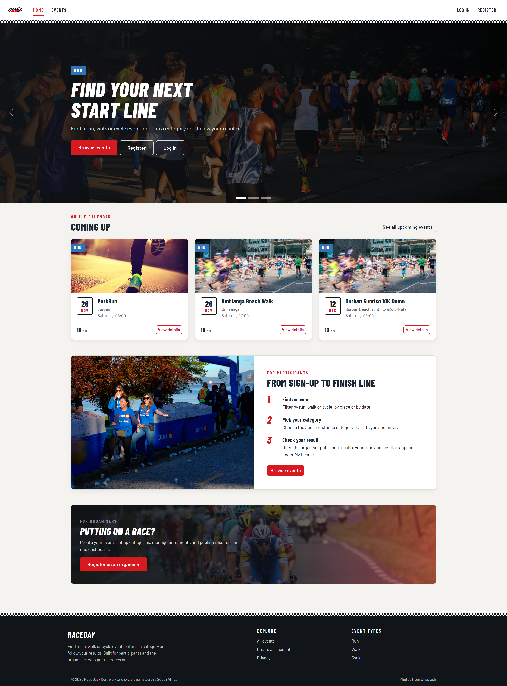
  <br>
  <em>Figure P3-1: Login page with the image-left, form-right layout.</em>
</p>

<p align="center">
  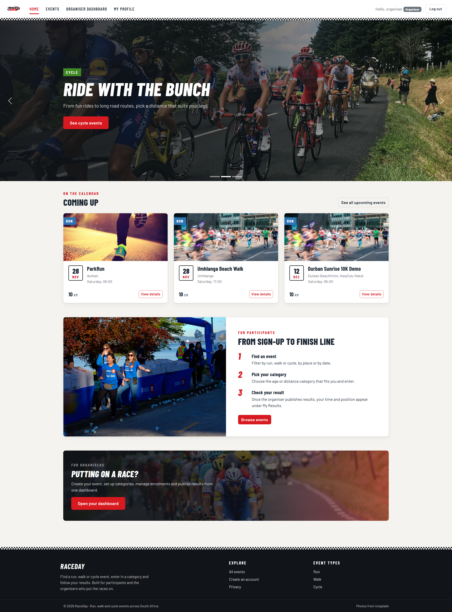
  <br>
  <em>Figure P3-2: Organiser navigation menu, shown after logging in as an Organiser.</em>
</p>

<p align="center">
  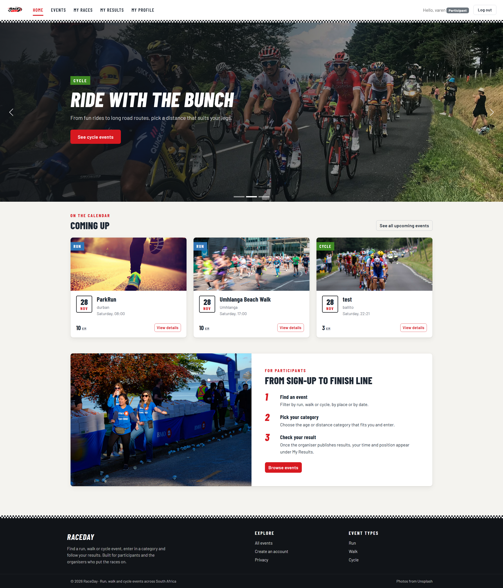
  <br>
  <em>Figure P3-3: Participant navigation menu, showing a different menu for the other role.</em>
</p>

---

## Part 3 Organiser Interface

| Page | What it does |
|---|---|
| **Dashboard** | Summary tiles (total events, upcoming, past, total enrolments), the next event date, and a table of the Organiser's events with the number of enrolments and their status breakdown. |
| **Events management** | Create, edit and delete events with name, description, date, location, distance and event type. A banner image can be uploaded when creating or editing. |
| **Event details** | Full event information with the banner and quick actions. |
| **Categories** | Add, edit and delete age or distance categories for each event. |
| **Enrolments** | All Participants enrolled in a specific event, with their selected category and an enrolment status that the Organiser can change. |
| **Results** | Capture, edit and publish finish times and finishing positions for enrolled Participants. |

Ownership is enforced: an Organiser can only open and change their own events, and the API repeats this check.

<p align="center">
  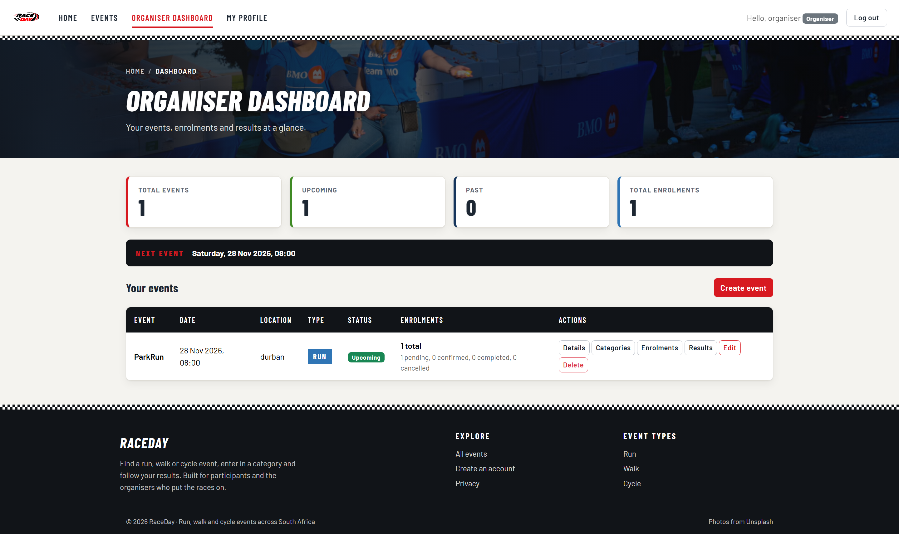
  <br>
  <em>Figure P3-4: Organiser dashboard with summary tiles, the next event and the events table.</em>
</p>

<p align="center">
  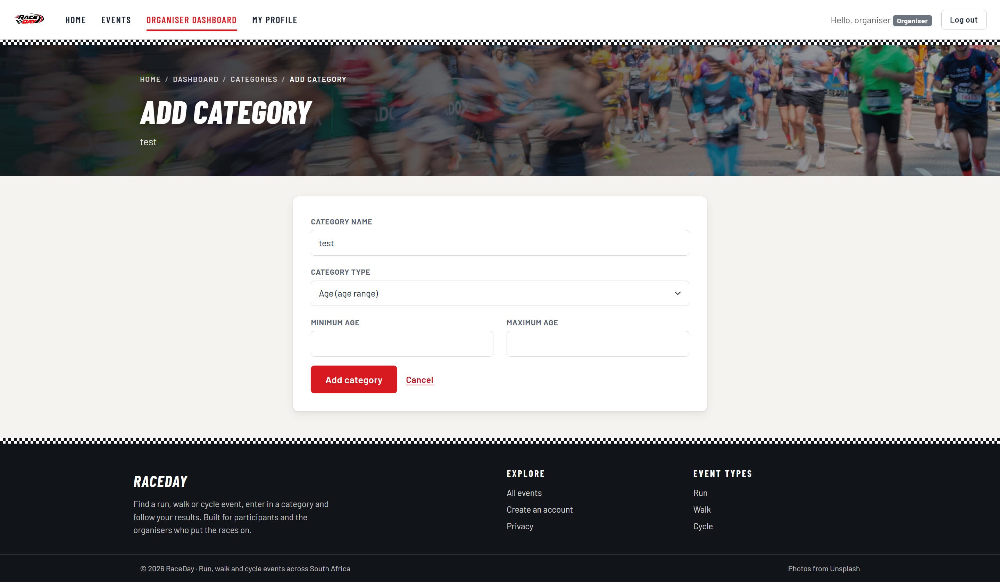
  <br>
  <em>Figure P3-6: Category management for an event.</em>
</p>

<p align="center">
  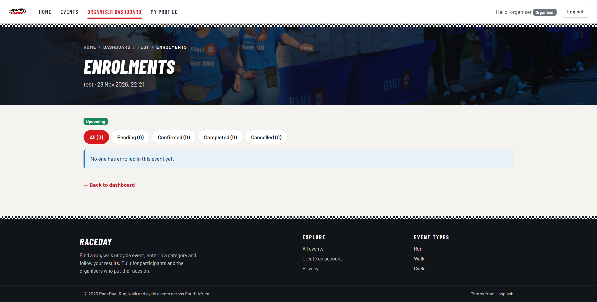
  <br>
  <em>Figure P3-7: Enrolments for an event, with each Participant's category and status.</em>
</p>

<p align="center">
  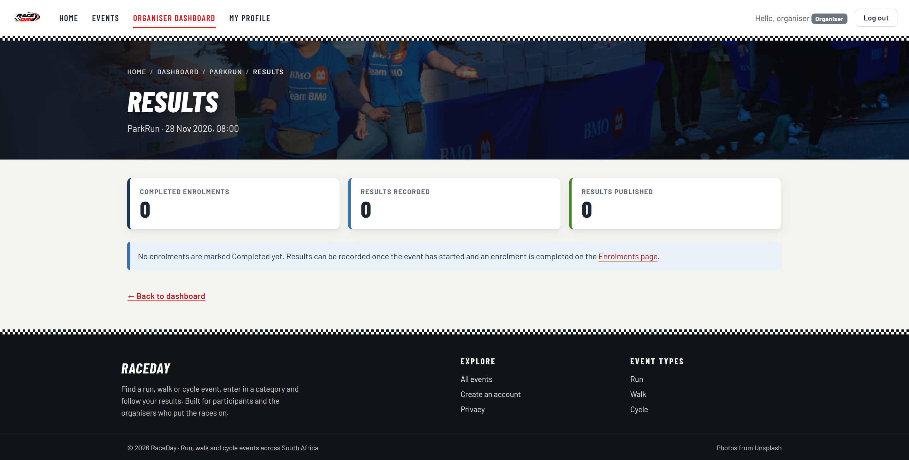
  <br>
  <em>Figure P3-8: Results entry, capturing finish times and finishing positions.</em>
</p>

---

## Part 3 Participant Interface

| Page | What it does |
|---|---|
| **Home** | Hero carousel and upcoming events. |
| **Events** | All upcoming events with filtering by event type, location and date. |
| **Event details** | Full event information, the banner image, race facts and the available categories, with an **Enter Event** form where the Participant selects a category. The enrolment is recorded immediately. |
| **My Races** | Every event the Participant has enrolled for, with a colour-coded enrolment status. |
| **My Results** | Race history across completed events, showing event name, date, category, finish time and finishing position (for example 47th out of 312 finishers). |
| **Profile** | View and update personal details and upload a profile picture. |

<p align="center">
  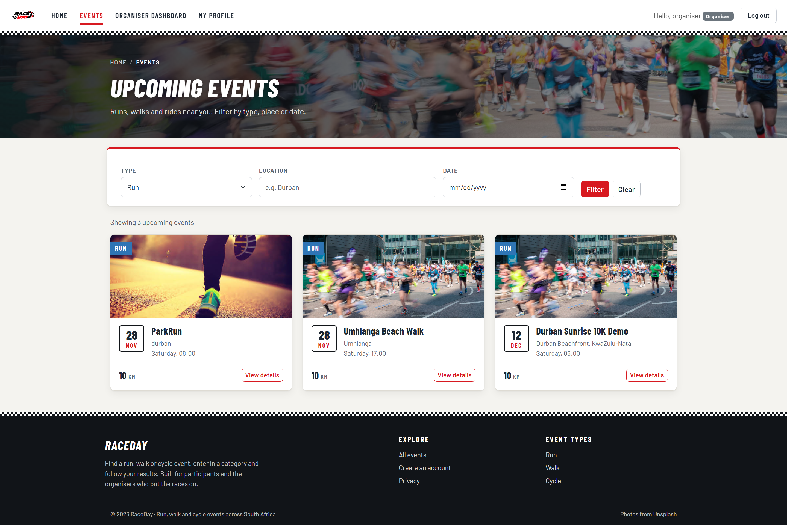
  <br>
  <em>Figure P3-9: Events page filtered by event type, location and date.</em>
</p>

<p align="center">
  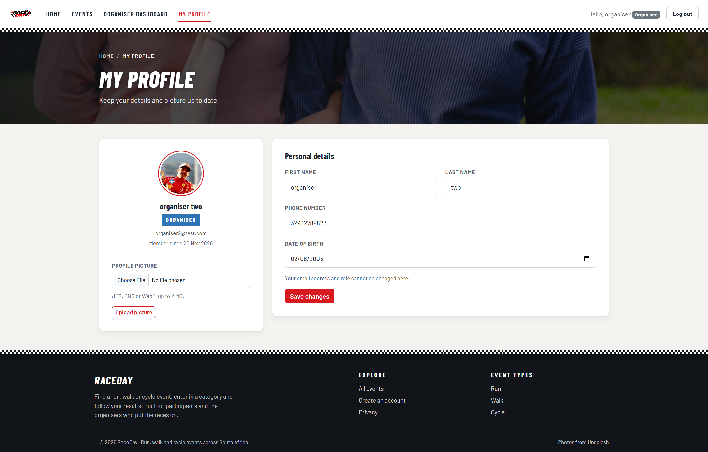
  <br>
  <em>Figure P3-11: Profile page with a profile picture uploaded through the API.</em>
</p>

---

## Part 3 Azure Blob Storage

Azure Blob Storage is integrated into the **API**. The MVC application never communicates with Azure; it only sends the file to the API, as the brief requires (Microsoft, n.d.-r).

```text
Organiser chooses a banner on the Create or Edit event form
        │  multipart/form-data
        ▼
MVC: ImageFileRules   → checks size (2 MB), extension and file signature
        │  PostFileAsync (field name "file", with content type)
        ▼
API: POST /api/events/{id}/banner
        │  ImageUploadValidator → reads the first bytes to confirm a real JPG, PNG or WebP
        │  BlobStorageService   → uploads the stream to Azure with the correct content type
        ▼
Azure Blob Storage   → stores the image under a random blob name
        │  returns the blob URL
        ▼
SQL Server (EVENT.BANNER_IMAGE_URL)  → URL saved to the database
        ▼
MVC event details page →  loads the image from the Azure URL
```

| Feature | Detail |
|---|---|
| Event banner | Uploaded when an event is created or edited, saved as `BANNER_IMAGE_URL`, shown on the event details page and event cards. |
| Profile picture | Uploaded from the profile page through `POST /api/users/me/profile-image`, saved as `PROFILE_IMAGE_URL`. |
| Allowed files | JPG, PNG or WebP, up to 2 MB. |
| Validation | The MVC form rejects a bad file before the event is saved. The API repeats the check on the file's real bytes, so a renamed file cannot get through (Microsoft, n.d.-p). |
| Blob naming | Random GUID names, so users cannot overwrite or guess other files. |
| Secrets | The connection string is kept in user secrets or environment variables and is never committed. |
| Failure handling | If Azure is unavailable the API reports that image storage is unavailable, and the MVC application shows that as a message. A failed banner upload never loses the event details. |

<p align="center">
  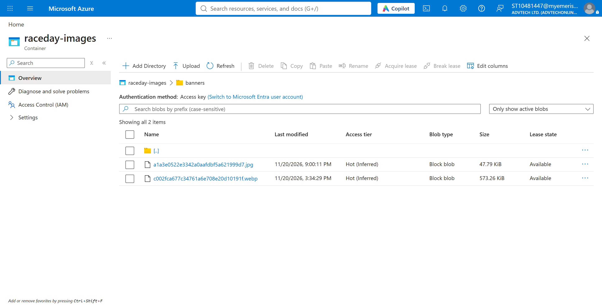
  <br>
  <em>Figure P3-12: The Azure Blob container in the Azure portal, showing the uploaded event banner and profile picture.</em>
</p>

---

## Part 3 UI Design

The interface reflects the RaceDay brand and the three event types.

| Design decision | Detail |
|---|---|
| Colours | Brand red and black from the logo, with Run blue, Walk navy and Cycle green from the Part 1 documents. Warm paper background. |
| Typography | Barlow Condensed for headings and Barlow for body text (Google, n.d.). |
| Global style sheet | One file, `wwwroot/css/site.css`, with design tokens at the top. No page uses its own styles, so fonts, colours, spacing and components are the same on every page. |
| Imagery | Home carousel (Run, Cycle, Walk), an image banner on every page and image-left, content-right sections. Photographs are from Unsplash and are used under the Unsplash licence (Unsplash, n.d.). |
| Navigation | Sticky navbar with a role-specific menu, the chequered-flag strip, breadcrumbs under every page banner and a full footer. |
| Cards | Event cards with a photo, type tag and date, and statistic tiles on the dashboard. |
| Status colours | Every enrolment status has its own coloured badge, for example green for Confirmed and amber for Pending. |
| Responsiveness | Bootstrap 5.3 grid and components, so pages adapt to phones, tablets and desktops (Bootstrap, n.d.). |
| Accessibility | Skip link, alt text, labelled form fields and reduced-motion support. |

### Validation and error handling

- Forms validate on the client with jQuery Validation and again on the server with model validation.
- Bad input is shown next to the field, for example an event date in the past, a missing field or an invalid image.
- API errors (`400`, `401`, `403`, `404`, `409` and unavailable service) are converted to friendly messages by the API client.
- An unexpected exception shows the Error page, never a stack trace.
- The application reads numbers and dates with a fixed `en-US` culture, so a distance such as `5.5` behaves the same on every computer and inside a container (Microsoft, n.d.-q).

---

## Part 3 Docker

The MVC application runs in a container built from `RaceDay.Web/Dockerfile`, a multi-stage build that compiles with the .NET SDK image and runs on the smaller ASP.NET runtime image (Microsoft, n.d.-t).

| Dockerfile feature | Purpose |
|---|---|
| Multi-stage build | The SDK image builds and publishes. Only the published output reaches the runtime image. |
| Restore before copy | The project file is copied and restored first, so Docker caches the packages when only source files change. |
| Runtime image | `mcr.microsoft.com/dotnet/aspnet:10.0` is smaller and contains no build tools. |
| Port | The container listens on port `8080` (`ASPNETCORE_HTTP_PORTS=8080`). |

### Run with one command

The Dockerfile copies `RaceDay.Web/`, so the image is built from the **repository root**.

```bash
docker build -f RaceDay.Web/Dockerfile -t raceday-web . && docker run --rm -p 8080:8080 -e RaceDayApi__BaseUrl=https://host.docker.internal:7226/ -e RaceDayApi__AllowInvalidCertificate=true --name raceday-web raceday-web
```

Then open **http://localhost:8080**.

| Part of the command | Why it is needed |
|---|---|
| `-f RaceDay.Web/Dockerfile ... .` | Builds from the repository root. |
| `-p 8080:8080` | Publishes the container port on the computer. |
| `RaceDayApi__BaseUrl` | Inside the container `localhost` is the container itself, so the API is reached through `host.docker.internal`. The double underscore overrides `RaceDayApi:BaseUrl` from `appsettings.json`. |
| `RaceDayApi__AllowInvalidCertificate=true` | Accepts the API's development certificate. Use this for local Docker only. |

### Before you run the container

Start the API so that it accepts requests from outside `localhost`:

```bash
dotnet run --project RaceDay.Api -- --urls "https://0.0.0.0:7226" --environment Development
```

Allow the connection through the Windows firewall if prompted. The API continues to use SQL Server LocalDB and Azure Blob Storage exactly as it does when run locally, so the containerised MVC application behaves the same as the local one.

### Docker troubleshooting

| Problem | Likely cause and fix |
|---|---|
| "The RaceDay service is currently unavailable" in the container | The API is not running, or it is only listening on `localhost`. Start it with `--urls "https://0.0.0.0:7226"`. |
| `docker build` cannot find `RaceDay.Web.csproj` | The command was run from the wrong folder. Run it from the repository root. |
| Port 8080 already in use | Change the left side of the mapping, for example `-p 9090:8080`, and open `http://localhost:9090`. |
| Certificate error calling the API | Set `RaceDayApi__AllowInvalidCertificate=true`. |

To stop the container, press `Ctrl+C`, or run `docker stop raceday-web`.

---

## Part 3 CI/CD Pipeline

The GitHub Actions workflow [`raceday-part2-ci.yml`](.github/workflows/raceday-part2-ci.yml) runs on every push and pull request. In Part 3 it was extended so that it also restores and builds the MVC project, in addition to building the API and running the 75 MSTest tests (GitHub, n.d.-c).

| Step | Purpose |
|---|---|
| Checkout repository | Obtain the committed source on a clean runner |
| Set up .NET 10 | Use the same SDK major version as the applications |
| Validate structure | Confirm the solution, test project and README exist |
| Restore and build the API solution | Compile the API and test project |
| Run MSTest suite | Run all API tests |
| Restore and build `RaceDay.Web` | Prove the MVC application compiles |
| Upload test results | Keep the `.trx` results as a workflow artifact |

<p align="center">
  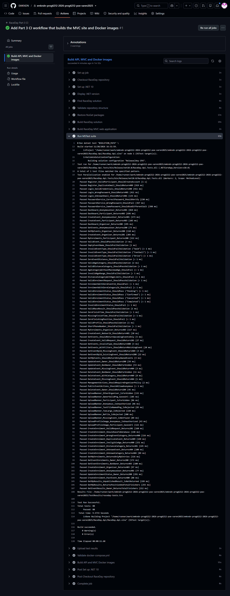
  <br>
  <em>Figure P3-13: Successful GitHub Actions run building the RaceDay API and the RaceDay.Web MVC project.</em>
</p>

### Version control

Part 3 work was committed to the `part-3-raceday-mvc` branch from my own GitHub account, with meaningful commits for the project setup, API client, authentication, role navigation, Organiser pages, Participant pages, Blob Storage integration, Docker, styling and documentation.

---

## Part 3 Demo Walkthrough

1. Open the home page, view the carousel and the upcoming events.
2. Register an **Organiser** and log in. Note the Organiser menu.
3. Create an event with a banner image, then add categories.
4. Open the event details page and confirm the banner loads from Azure Blob Storage.
5. Log out, then register a **Participant** and log in. Note the different menu.
6. Filter events, open the event, select a category and enter the event.
7. Open **My Races** and see the colour-coded enrolment status.
8. Upload a profile picture on the profile page.
9. As the Organiser, open the event's enrolments and change a status, then capture and publish a result.
10. As the Participant, open **My Results** and see the finish time and position.
11. Try an invalid file and an invalid date to see the friendly validation messages.
12. Try to open an Organiser page as a Participant, and a protected page while logged out.

---

## Part 3 Evidence Index

All Part 3 screenshots are in `docs/Screenshots/`. Image paths are case-sensitive on GitHub.

| Figure | Evidence | File |
|---|---|---|
| P3-1 | Login page | `docs/Screenshots/part3-login.png` |
| P3-2 | Organiser menu | `docs/Screenshots/part3-organiser-menu.png` |
| P3-3 | Participant menu | `docs/Screenshots/part3-participant-menu.png` |
| P3-4 | Organiser dashboard | `docs/Screenshots/part3-organiser-dashboard.png` |
| P3-5 | Create event with banner | `docs/Screenshots/part3-event-create.png` |
| P3-6 | Category management | `docs/Screenshots/part3-categories.png` |
| P3-7 | Organiser enrolments | `docs/Screenshots/part3-organiser-enrolments.png` |
| P3-8 | Results entry | `docs/Screenshots/part3-organiser-results.png` |
| P3-9 | Event filtering | `docs/Screenshots/part3-events-filter.png` |
| P3-10 | My races with coloured statuses | `docs/Screenshots/part3-my-races.png` |
| P3-11 | Profile picture | `docs/Screenshots/part3-profile-picture.png` |
| P3-12 | Azure Blob container | `docs/Screenshots/part3-azure-blob-container.png` |
| P3-13 | Green GitHub Actions build (API and MVC) | `docs/Screenshots/part3-ci-green-build.png` |

---

## Part 3 Video Demonstration

<p align="center">
  <a href="https://youtu.be/ADD_PART_3_VIDEO_ID">
    
  </a>
</p>

**Unlisted YouTube link:** https://youtu.be/ADD_PART_3_VIDEO_ID

The video demonstrates the running application with the student's own voice-over and covers:

1. The RaceDay system and the Part 3 scope.
2. The MVC structure: controllers, views, the API client and why the MVC project has no database or Azure code.
3. Registration, login, logout and the distinct Organiser and Participant menus, with protected pages redirecting.
4. The Organiser pages: dashboard, events, categories, enrolments and results.
5. The Participant pages: home and filtering, event details and enrolment, my races, my results and profile.
6. The Blob Storage integration: the file travelling from MVC to the API to Azure, the URL in the database and the image displayed.
7. The Docker setup: the Dockerfile, the single run command and the running container.
8. The styling approach and validation, including invalid input handled without raw errors.
9. The green GitHub Actions build.

---

## Part 3 AI Usage Disclosure

<p align="center">
  <a href="docs/AI_Disclosure_ST10481447.pdf">
    
  </a>
</p>

---

## Part 3 Code Attribution

Every Part 3 source file contains a code attribution block naming the documentation that informed it. These sources were used as references and were not copied as complete solutions.

| Area | Source and use |
|---|---|
| Typed HTTP client | Microsoft, *Make HTTP requests using IHttpClientFactory in ASP.NET Core* - the API client and its message handlers |
| Session | Microsoft, *Session and state management in ASP.NET Core* - user ID, role and session settings |
| Filters | Microsoft, *Filters in ASP.NET Core* - the `RequireRole` filter |
| Routing | Microsoft, *Routing to controller actions in ASP.NET Core* - the Organiser attribute routes |
| Forms | Microsoft, *Tag Helpers in forms in ASP.NET Core* - form fields, validation messages and anti-forgery tokens |
| Anti-forgery | Microsoft, *Prevent Cross-Site Request Forgery (XSRF/CSRF) attacks in ASP.NET Core* - protecting create, edit and delete forms |
| File upload | Microsoft, *Upload files in ASP.NET Core* and *MultipartFormDataContent Class* - receiving a file and forwarding it to the API |
| Localization | Microsoft, *Configure ASP.NET Core Localization* - a fixed request culture |
| Blob Storage | Microsoft, *Upload a blob with .NET* - uploading image streams with a content type |
| Secrets | Microsoft, *Safe storage of app secrets in development* - keeping the connection string out of the repository |
| Docker | Microsoft, *Building .NET Docker images* - the multi-stage Dockerfile |
| Carousel and layout | Bootstrap, *Carousel* - the home page carousel |
| Fonts and photography | Google Fonts (Barlow) and Unsplash - typography and images |

---

## Part 3 Bibliography

Bootstrap, n.d. *Carousel*. Bootstrap 5.3 Documentation. [online] Available at: <https://getbootstrap.com/docs/5.3/components/carousel/> [Accessed 20 November 2026].

GitHub, n.d.-c. *Building and testing .NET*. GitHub Docs. [online] Available at: <https://docs.github.com/en/actions/tutorials/build-and-test-code/net> [Accessed 19 October 2026].

Google, n.d. *Barlow*. Google Fonts. [online] Available at: <https://fonts.google.com/specimen/Barlow> [Accessed 20 November 2026].

The Independent Institute of Education, 2026. *PROG6212 Programming 2B: Portfolio of Evidence Brief and Marking Rubrics*. [unpublished assignment brief]. The Independent Institute of Education (Pty) Ltd.

Microsoft, n.d.-g. *Session and state management in ASP.NET Core*. Microsoft Learn. [online] Available at: <https://learn.microsoft.com/en-us/aspnet/core/fundamentals/app-state> [Accessed 19 October 2026].

Microsoft, n.d.-l. *Make HTTP requests using IHttpClientFactory in ASP.NET Core*. Microsoft Learn. [online] Available at: <https://learn.microsoft.com/en-us/aspnet/core/fundamentals/http-requests> [Accessed 17 November 2026].

Microsoft, n.d.-m. *Filters in ASP.NET Core*. Microsoft Learn. [online] Available at: <https://learn.microsoft.com/en-us/aspnet/core/mvc/controllers/filters> [Accessed 19 November 2026].

Microsoft, n.d.-n. *Routing to controller actions in ASP.NET Core*. Microsoft Learn. [online] Available at: <https://learn.microsoft.com/en-us/aspnet/core/mvc/controllers/routing> [Accessed 19 November 2026].

Microsoft, n.d.-o. *Prevent Cross-Site Request Forgery (XSRF/CSRF) attacks in ASP.NET Core*. Microsoft Learn. [online] Available at: <https://learn.microsoft.com/en-us/aspnet/core/security/anti-request-forgery> [Accessed 19 November 2026].

Microsoft, n.d.-p. *Upload files in ASP.NET Core*. Microsoft Learn. [online] Available at: <https://learn.microsoft.com/en-us/aspnet/core/mvc/models/file-uploads> [Accessed 20 November 2026].

Microsoft, n.d.-q. *Configure ASP.NET Core Localization*. Microsoft Learn. [online] Available at: <https://learn.microsoft.com/en-us/aspnet/core/fundamentals/localization/select-language-culture> [Accessed 19 November 2026].

Microsoft, n.d.-r. *Upload a blob with .NET*. Microsoft Learn. [online] Available at: <https://learn.microsoft.com/en-us/azure/storage/blobs/storage-blob-upload> [Accessed 20 November 2026].

Microsoft, n.d.-s. *Safe storage of app secrets in development in ASP.NET Core*. Microsoft Learn. [online] Available at: <https://learn.microsoft.com/en-us/aspnet/core/security/app-secrets> [Accessed 20 November 2026].

Microsoft, n.d.-t. *Building .NET Docker images*. Microsoft Learn. [online] Available at: <https://learn.microsoft.com/en-us/aspnet/core/host-and-deploy/docker/building-net-docker-images> [Accessed 20 November 2026].

Unsplash, n.d. *Unsplash License*. [online] Available at: <https://unsplash.com/license> [Accessed 20 November 2026].

---

## Part 3 Submission Checklist

- [x] GitHub repository link submitted on ARC, with Part 3 on the `part-3-raceday-mvc` branch.
- [x] 20 or more meaningful Part 3 commits from my own GitHub account.
- [x] MVC application consuming the Part 2 API, with no database access or Azure code in the MVC project.
- [x] Register, login, logout, session and distinct role menus, with protected pages redirecting.
- [x] Organiser dashboard, events, categories, enrolments and results pages.
- [x] Participant home with filtering, event details, enrolment, my races, my results and profile pages.
- [x] Azure Blob Storage integrated through the API, with the URL stored in the database and the image displayed.
- [x] Dockerfile and a single Docker run command in this README.
- [x] Consistent, responsive RaceDay UI with colour-coded enrolment statuses.
- [x] GitHub Actions workflow builds the API and the MVC project, with a green build screenshot.
- [x] Code attribution blocks, Harvard referencing and a Part 3 bibliography.
- [x] AI usage disclosure.
- [ ] Unlisted Part 3 YouTube video link added to this README (replace `ADD_PART_3_VIDEO_ID`).

---

## Part 3 Student Contribution

**Varen Venketraju (ST10481447)**

Responsible for the complete PROG6212 POE Part 3 RaceDay submission, including:

- Building the ASP.NET Core MVC application that consumes the Part 2 API.
- Implementing the typed API client, session handling and the role filter.
- Building the register, login and logout flow with distinct Organiser and Participant navigation.
- Building the Organiser dashboard, event, category, enrolment and result pages.
- Building the Participant home, event, enrolment, my races, my results and profile pages.
- Integrating Azure Blob Storage into the API for event banners and profile pictures.
- Validating uploaded images in both the MVC application and the API.
- Designing the RaceDay interface and global style sheet.
- Writing the Dockerfile and documenting the Docker run command.
- Extending the GitHub Actions workflow to build the MVC project.
- Adding code attribution and Harvard referencing.
- Updating this README.
- Preparing the Part 3 demonstration video.

---

<p align="center">
  <sub>PROG6212 Programming 2B - Portfolio of Evidence Parts 1, 2 &amp; 3</sub>
  <br>
  <sub>RaceDay Event Management System</sub>
  <br>
  <sub>Varen Venketraju - ST10481447</sub>
</p>
